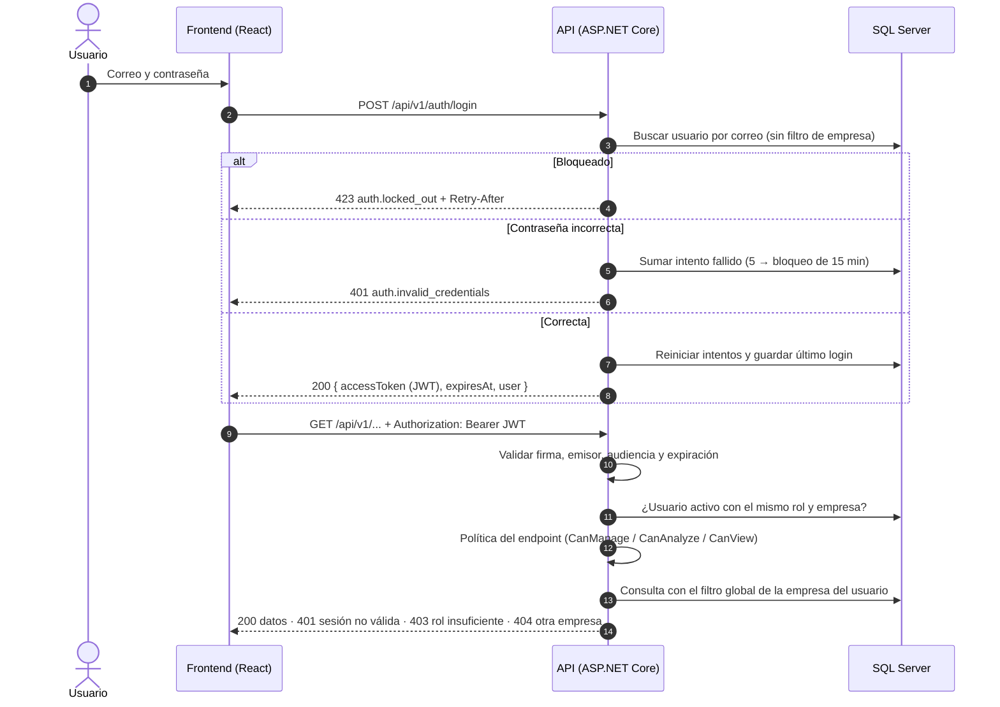

# Parte II: Documentación técnica

## Arquitectura del sistema

### Stack tecnológico

| Capa | Tecnología |
|---|---|
| API principal | C# / ASP.NET Core (.NET 10), Entity Framework Core |
| Base de datos | SQL Server 2022 |
| Servicio de IA | Python 3.12 + FastAPI, Claude (Anthropic), scikit-learn, rapidfuzz |
| Frontend | React 18 + TypeScript + Vite + Tailwind CSS + shadcn/ui + Recharts |
| Hosting | Azure, AWS o GCP |

#### Versiones exactas (Etapa 00)

| Componente | Paquete / herramienta | Versión |
|---|---|---|
| API | .NET SDK / ASP.NET Core runtime | 10.0.115 / 10.0.15 |
| API | Microsoft.AspNetCore.OpenApi | 10.0.15 |
| API | Scalar.AspNetCore | 2.21.0 |
| API | Serilog.AspNetCore | 10.0.0 |
| API | Asp.Versioning.Mvc / ApiExplorer / OpenApi | 10.2.1 / 10.2.1 / 10.2.3 |
| API | Microsoft.AspNetCore.Authentication.JwtBearer | 10.0.15 |
| Datos | Microsoft.EntityFrameworkCore.SqlServer / Sqlite / Design · dotnet-ef | 10.0.15 |
| Pruebas .NET | Testcontainers.MsSql | 4.16.0 |
| Aplicación | FluentValidation | 12.2.0 |
| Pruebas .NET | xunit.v3 · Shouldly · Microsoft.AspNetCore.Mvc.Testing | 3.2.2 · 4.3.0 · 10.0.15 |
| Base de datos | SQL Server (imagen `mcr.microsoft.com/mssql/server:2022-latest`) | 2022 |
| IA | Python | 3.12 |
| IA | fastapi · uvicorn · pydantic · pydantic-settings | 0.163.1 · 0.54.0 · 2.14.3 · 2.16.3 |
| IA | pandas · scikit-learn · rapidfuzz · anthropic | 3.1.1 · 1.9.1 · 3.14.6 · 2.8.0 |
| IA (dev) | pytest · httpx · ruff | 9.2.0 · 0.28.1 · 0.17.5 |
| Frontend | Node.js (mínimo) | 20.19 (CI usa 22) |
| Frontend | react · react-dom | 18.3.1 |
| Frontend | vite · @vitejs/plugin-react · typescript | 8.3.8 · 6.3.0 · 5.9 |
| Frontend | tailwindcss · shadcn/ui (estilo new-york) | 3.4.19 · componentes copiados |
| Frontend | @tanstack/react-query · lucide-react | 5.107.1 · 1.73.0 |
| Frontend (dev) | vitest · @testing-library/react · eslint · prettier | 5.1.0 · 16.3.3 · 10.15.0 · 3.10.1 |

Las versiones de .NET se fijan en `backend/Directory.Packages.props`; las de Python, como
mínimos en `ai-service/pyproject.toml`; y las del frontend, en `frontend/package-lock.json`.

### Componentes

| Componente | Se comunica con | Cómo |
|---|---|---|
| Frontend (React) | API ASP.NET Core | HTTPS + token JWT |
| API ASP.NET Core | SQL Server | Entity Framework Core |
| API ASP.NET Core | Servicio de IA (Python) | HTTP interno con clave de servicio |
| Servicio de IA | Claude (Anthropic) | API de Anthropic (solo datos agregados) |

El API .NET concentra los datos, la seguridad y la lógica determinista (KPIs, reglas, impacto
y score). El servicio de IA no tiene base de datos: recibe información agregada y devuelve
sugerencias. Si el servicio de IA no está disponible, la plataforma sigue funcionando.

### Diagrama de componentes

```
┌──────────────────────┐   HTTPS + JWT    ┌──────────────────────────┐   EF Core   ┌─────────────────┐
│  Frontend (React)    │ ───────────────► │  API ASP.NET Core (.NET) │ ──────────► │ SQL Server 2022 │
│  Vite · shadcn/ui    │                  │  /api/v1 · /health       │             └─────────────────┘
│  :5173 (dev) / :8081 │                  │  :5080 (dev) / :8080     │
└──────────────────────┘                  └────────────┬─────────────┘
                                                       │ HTTP interno
                                                       │ X-Internal-Api-Key
                                                       ▼
                                          ┌──────────────────────────┐   HTTPS   ┌──────────────┐
                                          │ Servicio de IA (FastAPI) │ ────────► │ Claude API   │
                                          │ stateless · :8001        │           │ (Anthropic)  │
                                          └──────────────────────────┘           └──────────────┘
```

- El frontend **solo** llama al API .NET.
- El servicio de IA no tiene base de datos y exige la cabecera `X-Internal-Api-Key` en todas
  las rutas excepto `/health`.
- Si el servicio de IA no responde, el API sigue funcionando (fallbacks y timeouts, Etapa 04).

### Capas del API (arquitectura limpia)

| Proyecto | Responsabilidad | Depende de |
|---|---|---|
| `Opsynex.Domain` | Entidades, enums y motores puros (KPIs, reglas, impacto, score) | nada |
| `Opsynex.Application` | Servicios, DTOs, validadores (FluentValidation) e interfaces | Domain |
| `Opsynex.Infrastructure` | EF Core, repositorios, parsers Excel/CSV, cliente del servicio de IA | Application |
| `Opsynex.Api` | Controllers, middleware, autenticación, `Program.cs` | Application, Infrastructure |

Unas pruebas de arquitectura (`LayerDependencyTests`) verifican que estas dependencias se respeten.

Convenciones transversales del API ya configuradas:

- **Rutas versionadas** `/api/v1/...` (Asp.Versioning, versión en el segmento de URL).
- **Errores** en formato ProblemDetails (RFC 7807) con `code` propio y `traceId`
  (por ejemplo, `404` → `"code": "not_found"`).
- **Logging estructurado** con Serilog (configurable en la sección `Serilog` de `appsettings`).
- **CORS** desde `Cors:Origins` (arreglo en `appsettings` o lista separada por comas en `Cors__Origins`).
- **OpenAPI + Scalar** en `/openapi/v1.json` y `/scalar`, solo en Development.
- **Health checks** en `/health` con respuesta JSON (`status`, `version`, `checks`): `self` y
  `database` (desde la Etapa 01; responde 503 si SQL Server no está disponible). La Etapa 04
  agrega el del servicio de IA.
- **Conflictos:** las violaciones de restricciones únicas se responden con `409 Conflict`
  (`"code": "conflict"`).
- **Acceso a datos:** EF Core 10 con SQL Server (compatibilidad 160), repositorios y unidad de
  trabajo, filtro global por empresa. Detalle en el capítulo *Modelo de datos*.

### Estructura de carpetas

```
opsynex-ai/
├── .github/workflows/ci.yml       CI: .NET, Python y frontend
├── docker-compose.yml             sqlserver, api, ai-service, frontend
├── .env.example                   variables de entorno de ejemplo
├── backend/
│   ├── Opsynex.sln                abre en Visual Studio 2022+/2026
│   ├── Directory.Build.props      Nullable, analizadores, warnings = errores en Release
│   ├── Directory.Packages.props   versiones centralizadas de NuGet
│   ├── Dockerfile                 build multi-stage (sdk → aspnet)
│   ├── src/Opsynex.Api|Application|Domain|Infrastructure/
│   └── tests/Opsynex.UnitTests|IntegrationTests/
├── ai-service/
│   ├── pyproject.toml · Dockerfile
│   ├── app/ (main.py, config.py, security.py, routers/, engines/, schemas/)
│   └── tests/
├── frontend/
│   ├── package.json · vite.config.ts · tailwind.config.ts · components.json · Dockerfile · nginx.conf
│   └── src/ (styles/tokens.css, lib/, components/ui/, components/<feature>/, pages/, test/)
├── docs/ (especificaciones, diseno, documentacion, Documentacion_Opsynex_AI.docx)
└── scripts/ (generar_documentacion.py, setup_cloud.sh)
```

### Flujo de datos

1. El usuario carga los archivos financieros.
2. El sistema valida la estructura.
3. El sistema normaliza (homologa) las cuentas.
4. Los datos se almacenan en la base de datos.
5. El motor de KPIs ejecuta los cálculos.
6. El motor de diagnóstico evalúa las condiciones.
7. El motor de impacto financiero estima las pérdidas.
8. El dashboard muestra los resultados.

### Seguridad

Requerimientos de las especificaciones (sección 19): autenticación JWT, encriptación de
contraseñas, validación de entradas, validación de archivos y control de acceso basado en
roles. Implementado en la Etapa 02:

- **Contraseñas:** hash con `PasswordHasher<User>` de ASP.NET Core Identity (PBKDF2 con
  HMAC-SHA512, sal aleatoria por usuario y 100 000 iteraciones). Nunca se guardan ni se
  devuelven en texto plano. Política: mínimo 8 caracteres con al menos una letra y un número.
  Si el algoritmo cambia en una versión futura, el hash se regenera en el siguiente login.
- **Sin auto-registro:** solo un Admin crea usuarios. El primer Admin se crea desde
  configuración (`Seed:AdminEmail` y `Seed:AdminPassword`) al arrancar o con el comando
  `dotnet run --project src/Opsynex.Api -- seed-admin`. El seed es idempotente y nunca cambia
  la contraseña de un usuario existente.
- **JWT:** HS256 con `Jwt:Secret` (mínimo 32 bytes; el API no arranca sin él), emisor
  `opsynex-api`, audiencia `opsynex-web` y expiración configurable (`Jwt:ExpireMinutes`, 60 por
  defecto, tolerancia de reloj de 30 s). Claims: `sub`, `email`, `role` y `company_id`.
- **Sesión verificada en cada petición:** además de la firma y la expiración, el API comprueba
  que el usuario siga activo y que su rol y empresa no hayan cambiado; si cambiaron, el token
  deja de servir (401 `auth.session_invalid`).
- **Bloqueo temporal:** 5 intentos fallidos consecutivos bloquean el login 15 minutos (423 con
  `Retry-After`); configurable en `Auth:MaxFailedAttempts` y `Auth:LockoutMinutes`. Un Admin
  lo quita al asignar una contraseña nueva.
- **Sin enumeración de usuarios:** un correo inexistente y una contraseña errónea devuelven el
  mismo error y tardan lo mismo (se verifica un hash ficticio).
- **Autorización:** todo endpoint exige sesión por defecto (*fallback policy*) salvo los marcados
  como públicos. Políticas `CanManage` (Admin), `CanAnalyze` (Admin, Analyst) y `CanView`
  (todos). Ver la matriz en el capítulo *API REST*.
- **Aislamiento por empresa:** `ICurrentUser` lee los claims y `HttpCurrentTenant` alimenta el
  filtro global de EF Core: Analyst y Client quedan fijos a su empresa (otra empresa → 404); el
  Admin ve todas o elige una con `X-Company-Id` / `?companyId=`. Una petición anónima no ve
  datos.
- **Errores uniformes:** ProblemDetails con `code` (`auth.invalid_credentials`,
  `auth.forbidden`, `auth.token_expired`, etc.).

> Pendiente (Etapas 03 y 13): validación de archivos, límites de tasa y revisión de seguridad.

#### Flujo de autenticación


