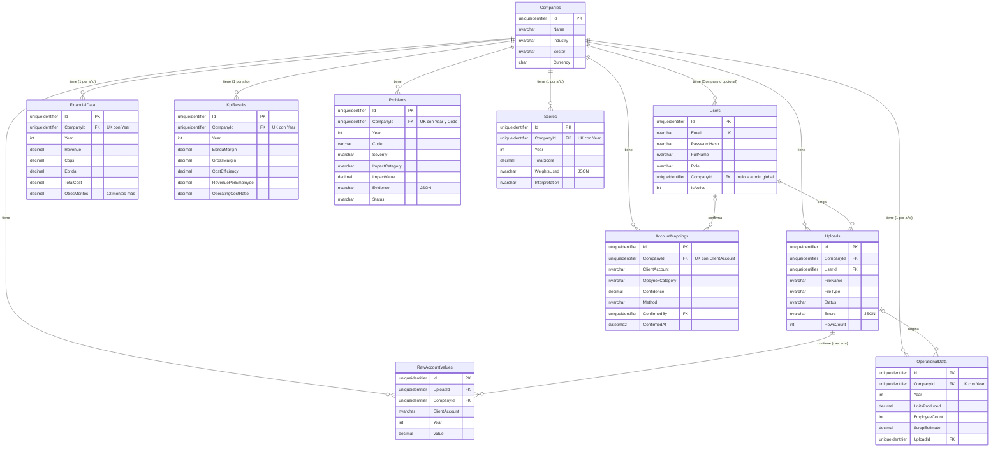

## Modelo de datos

Base de datos: **SQL Server 2022**, gestionada con **Entity Framework Core 10** (code-first y
migraciones). Las tablas de las especificaciones (`users`, `financial_data`, `operational_data`,
`kpi_results` y `problems`) se amplían con `Companies`, `Uploads`, `RawAccountValues`,
`AccountMappings` y `Scores` para soportar multi-empresa, la carga de archivos, la
homologación y el score.

### Convenciones

- **Claves:** todas las tablas tienen `Id` (`uniqueidentifier`, GUID v7 generado por la
  aplicación), `CreatedAt` y `UpdatedAt` (`datetime2`, UTC). Las fechas de auditoría las asigna
  un interceptor de EF Core (`AuditableEntityInterceptor`) al guardar.
- **Montos:** `decimal(18,2)`. **Ratios:** `decimal(9,4)` (0,1235 = 12,35 %). **Scores:**
  `decimal(5,2)`. **Confianza:** `decimal(5,4)`.
- **Enums:** se guardan como texto (`nvarchar(50)`), por ejemplo `Severity = 'High'`.
- **Columnas JSON:** `nvarchar(max)` con restricción `ISJSON(...) = 1`
  (`Uploads.Errors`, `Problems.Evidence`, `Scores.WeightsUsed`).
- **Multi-empresa:** todas las tablas de datos tienen `CompanyId` con índice. Un **filtro
  global** de EF Core (filtro con nombre `Company`) limita las consultas a la empresa del
  usuario cuando no es Admin. En la etapa 02 se conecta al usuario autenticado; hasta entonces
  el contexto no filtra. El login usa `IgnoreQueryFilters` porque aún no se conoce la empresa.
- **Datos anuales:** `FinancialData`, `OperationalData`, `KpiResults` y `Scores` son únicos
  por (`CompanyId`, `Year`) y tienen la restricción `Year BETWEEN 1900 AND 2200`.
- **Borrado:** ninguna relación con `Companies` borra en cascada (se evita perder datos por
  error). Solo `Uploads → RawAccountValues` es en cascada.
- **Valores nulos:** en `FinancialData`, `OperationalData` y `KpiResults` un valor nulo
  significa "no informado" o "no calculable"; nunca se reemplaza por cero.

### Diagrama entidad-relación



### Tablas

#### Companies

Empresas cliente.

| Columna | Tipo | Nulo | Descripción |
|---|---|---|---|
| Id | uniqueidentifier | No | Identificador (GUID v7). |
| Name | nvarchar(200) | No | Razón social o nombre comercial. |
| Industry | nvarchar(50) | No | `Manufacturing` o `Services`. |
| Sector | nvarchar(100) | Sí | Sector o subindustria (texto libre). |
| Currency | char(3) | No | Moneda ISO 4217 de los estados financieros (por defecto `USD`). |
| CreatedAt | datetime2 | No | Fecha de creación (UTC). |
| UpdatedAt | datetime2 | No | Última modificación (UTC). |

#### Users

Usuarios de la plataforma. Índice único en `Email`.

| Columna | Tipo | Nulo | Descripción |
|---|---|---|---|
| Id | uniqueidentifier | No | Identificador (GUID v7). |
| Email | nvarchar(256) | No | Correo, normalizado en minúsculas (único). |
| PasswordHash | nvarchar(512) | No | Hash de la contraseña (`PasswordHasher`, etapa 02). |
| FullName | nvarchar(200) | No | Nombre completo. |
| Role | nvarchar(50) | No | `Admin`, `Analyst` o `Client`. |
| CompanyId | uniqueidentifier | Sí | Empresa del usuario; nulo para un administrador global. |
| IsActive | bit | No | Si el usuario puede iniciar sesión. |
| CreatedAt | datetime2 | No | Fecha de creación (UTC). |
| UpdatedAt | datetime2 | No | Última modificación (UTC). |

#### Uploads

Archivos Excel/CSV cargados.

| Columna | Tipo | Nulo | Descripción |
|---|---|---|---|
| Id | uniqueidentifier | No | Identificador (GUID v7). |
| CompanyId | uniqueidentifier | No | Empresa dueña del registro (FK a Companies). |
| UserId | uniqueidentifier | No | Usuario que cargó el archivo (FK a Users). |
| FileName | nvarchar(260) | No | Nombre original del archivo. |
| FileType | nvarchar(50) | No | `IncomeStatement`, `BalanceSheet`, `CashFlow`, `CostStructure` u `Operational`. |
| Status | nvarchar(50) | No | `Pending`, `Validated`, `Failed` o `Processed`. |
| Errors | nvarchar(max) | No | JSON: lista de errores `{ code, message, row, column }`. |
| RowsCount | int | No | Filas leídas del archivo. |
| CreatedAt | datetime2 | No | Fecha de creación (UTC). |
| UpdatedAt | datetime2 | No | Última modificación (UTC). |

#### RawAccountValues

Valores por cuenta y año tal como vinieron en el archivo (antes de homologar). Se borran en cascada con su carga.

| Columna | Tipo | Nulo | Descripción |
|---|---|---|---|
| Id | uniqueidentifier | No | Identificador (GUID v7). |
| UploadId | uniqueidentifier | No | Carga de origen (FK a Uploads, borrado en cascada). |
| CompanyId | uniqueidentifier | No | Empresa dueña del registro (FK a Companies). |
| ClientAccount | nvarchar(300) | No | Nombre de la cuenta en el plan contable del cliente. |
| Year | int | No | Año fiscal (1900–2200). |
| Value | decimal(18,2) | No | Monto. |
| CreatedAt | datetime2 | No | Fecha de creación (UTC). |
| UpdatedAt | datetime2 | No | Última modificación (UTC). |

#### AccountMappings

Homologación de cuentas del cliente a categorías Opsynex. Único por (`CompanyId`, `ClientAccount`).

| Columna | Tipo | Nulo | Descripción |
|---|---|---|---|
| Id | uniqueidentifier | No | Identificador (GUID v7). |
| CompanyId | uniqueidentifier | No | Empresa dueña del registro (FK a Companies). |
| ClientAccount | nvarchar(300) | No | Cuenta del cliente. |
| OpsynexCategory | nvarchar(50) | No | Categoría estándar (ver catálogo). |
| Confidence | decimal(5,4) | No | Confianza de la sugerencia, de 0 a 1. |
| Method | nvarchar(50) | No | `Manual`, `Exact`, `Fuzzy` o `Ai`. |
| ConfirmedBy | uniqueidentifier | Sí | Usuario que confirmó el mapeo (FK a Users); nulo si es solo una sugerencia. |
| ConfirmedAt | datetime2 | Sí | Fecha de confirmación (UTC). |
| CreatedAt | datetime2 | No | Fecha de creación (UTC). |
| UpdatedAt | datetime2 | No | Última modificación (UTC). |

#### FinancialData

Estados financieros anuales homologados. Único por (`CompanyId`, `Year`). Los montos nulos significan "no informado".

| Columna | Tipo | Nulo | Descripción |
|---|---|---|---|
| Id | uniqueidentifier | No | Identificador (GUID v7). |
| CompanyId | uniqueidentifier | No | Empresa dueña del registro (FK a Companies). |
| Year | int | No | Año fiscal (1900–2200). |
| Revenue | decimal(18,2) | Sí | Ingresos. |
| Cogs | decimal(18,2) | Sí | Costo de ventas. |
| OperatingExpenses | decimal(18,2) | Sí | Gastos operacionales (OPEX). |
| Ebitda | decimal(18,2) | Sí | EBITDA. |
| TotalCost | decimal(18,2) | Sí | Costo total. |
| OverheadCost | decimal(18,2) | Sí | Gastos generales (overhead). |
| EnergyCost | decimal(18,2) | Sí | Costo de energía. |
| MaintenanceCost | decimal(18,2) | Sí | Costo de mantenimiento. |
| MaterialLoss | decimal(18,2) | Sí | Pérdida de materiales. |
| LaborCost | decimal(18,2) | Sí | Costo de personal. |
| Depreciation | decimal(18,2) | Sí | Depreciación y amortización. |
| NetIncome | decimal(18,2) | Sí | Utilidad neta. |
| TotalAssets | decimal(18,2) | Sí | Activos totales. |
| TotalLiabilities | decimal(18,2) | Sí | Pasivos totales. |
| Equity | decimal(18,2) | Sí | Patrimonio. |
| OperatingCashFlow | decimal(18,2) | Sí | Flujo de caja operativo. |
| CreatedAt | datetime2 | No | Fecha de creación (UTC). |
| UpdatedAt | datetime2 | No | Última modificación (UTC). |

#### OperationalData

Datos operacionales anuales. Único por (`CompanyId`, `Year`).

| Columna | Tipo | Nulo | Descripción |
|---|---|---|---|
| Id | uniqueidentifier | No | Identificador (GUID v7). |
| CompanyId | uniqueidentifier | No | Empresa dueña del registro (FK a Companies). |
| Year | int | No | Año fiscal (1900–2200). |
| UnitsProduced | decimal(18,2) | Sí | Unidades producidas. |
| EmployeeCount | int | Sí | Cantidad de empleados. |
| ScrapEstimate | decimal(18,2) | Sí | Scrap estimado (valor monetario). |
| EnergyCost | decimal(18,2) | Sí | Costo de energía. |
| OperationalCosts | decimal(18,2) | Sí | Costos operacionales. |
| EnergyConsumptionKwh | decimal(18,2) | Sí | Consumo de energía en kWh. |
| UploadId | uniqueidentifier | Sí | Carga de origen (FK a Uploads, opcional). |
| CreatedAt | datetime2 | No | Fecha de creación (UTC). |
| UpdatedAt | datetime2 | No | Última modificación (UTC). |

#### KpiResults

KPIs calculados por año. Único por (`CompanyId`, `Year`). Un KPI nulo no se pudo calcular.

| Columna | Tipo | Nulo | Descripción |
|---|---|---|---|
| Id | uniqueidentifier | No | Identificador (GUID v7). |
| CompanyId | uniqueidentifier | No | Empresa dueña del registro (FK a Companies). |
| Year | int | No | Año fiscal (1900–2200). |
| EbitdaMargin | decimal(9,4) | Sí | EBITDA / Revenue. |
| GrossMargin | decimal(9,4) | Sí | (Revenue − COGS) / Revenue. |
| CostEfficiency | decimal(9,4) | Sí | Total cost / Revenue. |
| RevenuePerEmployee | decimal(18,2) | Sí | Revenue / empleados (monto). |
| OperatingCostRatio | decimal(9,4) | Sí | Operating expenses / Revenue. |
| CalculatedAt | datetime2 | No | Fecha del cálculo (UTC). |
| CreatedAt | datetime2 | No | Fecha de creación (UTC). |
| UpdatedAt | datetime2 | No | Última modificación (UTC). |

#### Problems

Ineficiencias detectadas por el motor de diagnóstico. Único por (`CompanyId`, `Year`, `Code`).

| Columna | Tipo | Nulo | Descripción |
|---|---|---|---|
| Id | uniqueidentifier | No | Identificador (GUID v7). |
| CompanyId | uniqueidentifier | No | Empresa dueña del registro (FK a Companies). |
| Year | int | No | Año fiscal (1900–2200). |
| Code | varchar(64) | No | Código de la regla (p. ej. `EBITDA_DECLINE`). |
| Title | nvarchar(200) | No | Título del problema. |
| Description | nvarchar(4000) | No | Descripción con los datos que lo explican. |
| Category | nvarchar(50) | No | `Profitability`, `CostEfficiency`, `Productivity`, `FinancialStability` u `Operations`. |
| Severity | nvarchar(50) | No | `High`, `Medium` o `Low`. |
| ImpactCategory | nvarchar(50) | No | `MarginLoss`, `ExcessCost`, `ProductivityLoss` u `OperationalWaste`. |
| ImpactValue | decimal(18,2) | Sí | Pérdida económica estimada (etapa 07). |
| Recommendation | nvarchar(4000) | No | Recomendación base del motor de reglas. |
| AiRecommendation | nvarchar(max) | Sí | Recomendación generada por IA (etapa 11). |
| Evidence | nvarchar(max) | No | JSON libre con la evidencia del diagnóstico y del cálculo de impacto. |
| Status | nvarchar(50) | No | `Open`, `Acknowledged` o `Resolved`. |
| CreatedAt | datetime2 | No | Fecha de creación (UTC). |
| UpdatedAt | datetime2 | No | Última modificación (UTC). |

#### Scores

Score Opsynex por año (0–100). Único por (`CompanyId`, `Year`).

| Columna | Tipo | Nulo | Descripción |
|---|---|---|---|
| Id | uniqueidentifier | No | Identificador (GUID v7). |
| CompanyId | uniqueidentifier | No | Empresa dueña del registro (FK a Companies). |
| Year | int | No | Año fiscal (1900–2200). |
| TotalScore | decimal(5,2) | No | Score total (0–100). |
| ProfitabilityScore | decimal(5,2) | No | Dimensión rentabilidad. |
| CostEfficiencyScore | decimal(5,2) | No | Dimensión eficiencia de costos. |
| ProductivityScore | decimal(5,2) | No | Dimensión productividad. |
| FinancialStabilityScore | decimal(5,2) | No | Dimensión estabilidad financiera. |
| WeightsUsed | nvarchar(max) | No | JSON: peso usado por dimensión, p. ej. `{ "Profitability": 0.35 }`. |
| Interpretation | nvarchar(50) | No | `Healthy` (80–100), `Improvable` (60–79) o `Deteriorated` (0–59). |
| CreatedAt | datetime2 | No | Fecha de creación (UTC). |
| UpdatedAt | datetime2 | No | Última modificación (UTC). |

### Catálogo de categorías estándar (`OpsynexCategory`)

Las cuentas del cliente se homologan a estas categorías (etapa 04). El catálogo con nombres
y descripciones está en `Opsynex.Domain/Catalogs/OpsynexCategoryCatalog.cs`.

| Categoría | Nombre | Descripción | Estado financiero |
|---|---|---|---|
| `Revenue` | Ingresos | Ventas netas de bienes y servicios. | Estado de resultados |
| `Cogs` | Costo de ventas | Costo directo de los bienes vendidos o servicios prestados (COGS). | Estado de resultados |
| `OperatingExpenses` | Gastos operacionales | Gastos de administración y ventas (OPEX). | Estado de resultados |
| `OverheadCost` | Gastos generales | Costos indirectos o de estructura (overhead). | Estado de resultados |
| `EnergyCost` | Costo de energía | Electricidad, gas, combustibles y otros energéticos. | Estado de resultados |
| `MaterialLoss` | Pérdida de materiales | Mermas, desperdicio y scrap de materiales. | Estado de resultados |
| `MaintenanceCost` | Costo de mantenimiento | Mantenimiento preventivo y correctivo de equipos e instalaciones. | Estado de resultados |
| `LaborCost` | Costo de personal | Sueldos, salarios, cargas sociales y beneficios. | Estado de resultados |
| `Depreciation` | Depreciación y amortización | Depreciación de activos fijos y amortización de intangibles. | Estado de resultados |
| `Interest` | Intereses | Gastos financieros por intereses. | Estado de resultados |
| `Taxes` | Impuestos | Impuesto a la renta o sobre utilidades. | Estado de resultados |
| `NetIncome` | Utilidad neta | Resultado del ejercicio después de impuestos. | Estado de resultados |
| `TotalAssets` | Activos totales | Total de activos del balance. | Balance general |
| `TotalLiabilities` | Pasivos totales | Total de pasivos del balance. | Balance general |
| `Equity` | Patrimonio | Capital y reservas de los accionistas. | Balance general |
| `OperatingCashFlow` | Flujo de caja operativo | Efectivo generado por las operaciones. | Flujo de caja |
| `Other` | Otros | Cuentas que no corresponden a ninguna categoría estándar. | — |

### Acceso a datos

- `OpsynexDbContext` (Infrastructure) con una configuración `IEntityTypeConfiguration` por
  entidad en `Persistence/Configurations/`.
- Interfaces en Application (`Abstractions/Persistence`): `IRepository<T>` genérico,
  `ICompanyYearRepository<T>` (búsqueda por empresa y año, listado ordenado por año),
  `IUserRepository` (búsqueda por correo) e `IAccountMappingRepository`.
- `IUnitOfWork.SaveChangesAsync` confirma los cambios y convierte las violaciones de
  restricciones únicas (SQL Server 2601/2627) en `UniqueConstraintViolationException`, que el
  API traducirá a un `409 Conflict`.
- `ICurrentTenant` define la empresa del contexto. Por ahora se registra
  `UnrestrictedTenant` (sin filtro); la etapa 02 lo reemplaza por el usuario autenticado.

### Migraciones

Las migraciones viven en `backend/src/Opsynex.Infrastructure/Persistence/Migrations/`
(la primera es `InitialCreate`). `dotnet-ef` está fijado como herramienta local
(`backend/dotnet-tools.json`):

```bash
cd backend
dotnet tool restore
dotnet ef migrations add <Nombre> -p src/Opsynex.Infrastructure -s src/Opsynex.Api -o Persistence/Migrations
dotnet ef database update -p src/Opsynex.Infrastructure -s src/Opsynex.Api
```

En **Development** el API aplica las migraciones pendientes al arrancar
(`Database:MigrateOnStartup = true`). En producción se aplican de forma explícita en el
despliegue (etapa 14). Una prueba unitaria falla si el modelo cambia sin su migración.
