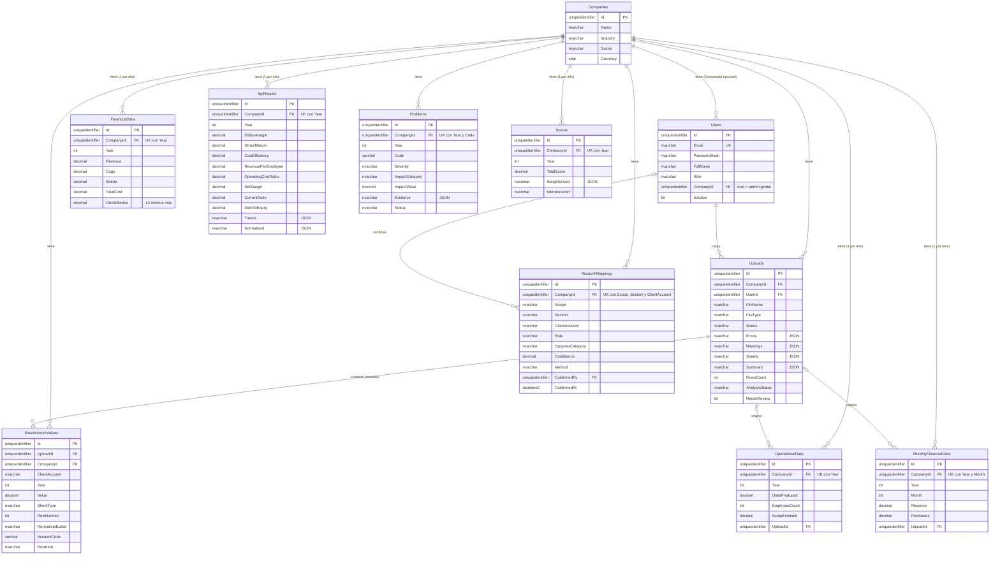

## Modelo de datos

Base de datos: **SQL Server 2022**, gestionada con **Entity Framework Core 10** (code-first y
migraciones). Las tablas de las especificaciones (`users`, `financial_data`, `operational_data`,
`kpi_results` y `problems`) se amplían con `Companies`, `Uploads`, `RawAccountValues`,
`AccountMappings` y `Scores` para soportar multi-empresa, la carga de archivos, la
homologación y el score.

### Convenciones

- **Claves:** todas las tablas tienen `Id` (`uniqueidentifier`, GUID v7 generado por la
  aplicación), `CreatedAt` y `UpdatedAt` (`datetime2`, UTC). Las fechas de auditoría las asigna
  un interceptor de EF Core (`AuditableEntityInterceptor`) al guardar.
- **Montos:** `decimal(18,2)`. **Ratios:** `decimal(9,4)` (0,1235 = 12,35 %). **Scores:**
  `decimal(5,2)`. **Confianza:** `decimal(5,4)`.
- **Enums:** se guardan como texto (`nvarchar(50)`), por ejemplo `Severity = 'High'`.
- **Columnas JSON:** `nvarchar(max)` con restricción `ISJSON(...) = 1`
  (`Uploads.Errors`, `Warnings`, `Sheets`, `Years` y `Summary`; `Problems.Evidence`;
  `Scores.WeightsUsed`).
- **Privacidad (etapa 03):** el archivo original no se guarda. De la nómina solo se guardan
  conteos y totales agregados; las etiquetas pasan por un filtro que reemplaza números de
  cuenta, cédulas y RNC por `***`; el nombre de la empresa del encabezado solo se usa para
  validar.
- **Multi-empresa:** todas las tablas de datos tienen `CompanyId` con índice. Un **filtro
  global** de EF Core (filtro con nombre `Company`) limita las consultas a la empresa del
  usuario cuando no es Admin. En la etapa 02 se conecta al usuario autenticado; hasta entonces
  el contexto no filtra. El login usa `IgnoreQueryFilters` porque aún no se conoce la empresa.
- **Datos anuales:** `FinancialData`, `OperationalData`, `KpiResults` y `Scores` son únicos
  por (`CompanyId`, `Year`) y tienen la restricción `Year BETWEEN 1900 AND 2200`.
- **Borrado:** ninguna relación con `Companies` borra en cascada (se evita perder datos por
  error). Solo `Uploads → RawAccountValues` es en cascada.
- **Valores nulos:** en `FinancialData`, `OperationalData` y `KpiResults` un valor nulo
  significa "no informado" o "no calculable"; nunca se reemplaza por cero.

### Diagrama entidad-relación



### Tablas

#### Companies

Empresas cliente.

| Columna | Tipo | Nulo | Descripción |
|---|---|---|---|
| Id | uniqueidentifier | No | Identificador (GUID v7). |
| Name | nvarchar(200) | No | Razón social o nombre comercial. |
| Industry | nvarchar(50) | No | `Manufacturing` o `Services`. |
| Sector | nvarchar(100) | Sí | Sector o subindustria (texto libre). |
| Currency | char(3) | No | Moneda ISO 4217 vigente de los estados financieros (por defecto `USD`; `DOP` para RD$). |
| CreatedAt | datetime2 | No | Fecha de creación (UTC). |
| UpdatedAt | datetime2 | No | Última modificación (UTC). |

#### Users

Usuarios de la plataforma. Índice único en `Email`.

| Columna | Tipo | Nulo | Descripción |
|---|---|---|---|
| Id | uniqueidentifier | No | Identificador (GUID v7). |
| Email | nvarchar(256) | No | Correo, normalizado en minúsculas (único). |
| PasswordHash | nvarchar(512) | No | Hash de la contraseña (`PasswordHasher<User>`). |
| FullName | nvarchar(200) | No | Nombre completo. |
| Role | nvarchar(50) | No | `Admin`, `Analyst` o `Client`. |
| CompanyId | uniqueidentifier | Sí | Empresa del usuario; nulo para un administrador global. |
| IsActive | bit | No | Si el usuario puede iniciar sesión. |
| CreatedAt | datetime2 | No | Fecha de creación (UTC). |
| UpdatedAt | datetime2 | No | Última modificación (UTC). |
| FailedLoginCount | int | No | Intentos de login fallidos consecutivos. |
| LastLoginAt | datetime2 | Sí | Último login correcto (UTC). |
| LockoutEndAt | datetime2 | Sí | Fin del bloqueo temporal (UTC); nulo si no está bloqueado. |

#### Uploads

Archivos cargados. **El archivo original no se guarda**: solo su reporte y los valores extraídos.

| Columna | Tipo | Nulo | Descripción |
|---|---|---|---|
| Id | uniqueidentifier | No | Identificador (GUID v7). |
| CompanyId | uniqueidentifier | No | Empresa dueña del registro (FK a Companies). |
| UserId | uniqueidentifier | No | Usuario que cargó el archivo (FK a Users). |
| FileName | nvarchar(260) | No | Nombre original del archivo. |
| FileType | nvarchar(50) | No | `AccountingWorkbook` (libro contable completo) o el tipo de plantilla: `IncomeStatement`, `BalanceSheet`, `CashFlow`, `CostStructure`, `Operational`. |
| Status | nvarchar(50) | No | `Pending`, `Validated`, `Failed` (error bloqueante) o `Processed` (etapa 04). |
| Errors | nvarchar(max) | No | JSON: errores bloqueantes `{ code, message, sheet, row, column }`. |
| RowsCount | int | No | Valores en bruto guardados (filas × años). |
| CreatedAt | datetime2 | No | Fecha de creación (UTC). |
| UpdatedAt | datetime2 | No | Última modificación (UTC). |
| FileSizeBytes | bigint | No | Tamaño del archivo. |
| Sheets | nvarchar(max) | No | JSON: hojas con su tipo detectado `{ name, detectedType, rowsExtracted, ignored, reason }`. |
| Summary | nvarchar(max) | No | JSON: resumen agregado (conteo de empleados y por departamento, nómina anual, meses con ventas, confiabilidad del balance de comprobación). Sin datos personales. |
| AnalysisStatus | nvarchar(50) | No | `NotStarted`, `Completed` o `Failed` (análisis automático). |
| NeedsReview | bit | No | Revisión recomendada: hay cuentas de los estados dudosas. |
| DoubtfulAccounts | int | No | Cantidad de cuentas dudosas. |
| ProcessedAt | datetime2 | Sí | Fecha del último análisis (UTC). |
| Warnings | nvarchar(max) | No | JSON: advertencias de calidad `{ code, message, sheet, row, column }`. |
| Years | nvarchar(max) | No | JSON: años detectados, p. ej. `[2023, 2024]`. |

#### RawAccountValues

Valores por fila y año tal como vinieron en el archivo (antes de homologar). Incluye los subtotales y totales (para validar y derivar). Se borran en cascada con su carga.

| Columna | Tipo | Nulo | Descripción |
|---|---|---|---|
| Id | uniqueidentifier | No | Identificador (GUID v7). |
| UploadId | uniqueidentifier | No | Carga de origen (FK a Uploads, borrado en cascada). |
| CompanyId | uniqueidentifier | No | Empresa dueña del registro (FK a Companies). |
| ClientAccount | nvarchar(300) | No | Cuenta del cliente usada para homologar (la etiqueta normalizada). |
| Year | int | No | Año fiscal (1900–2200). |
| Value | decimal(18,2) | No | Monto (una celda vacía no se guarda: no es cero). |
| CreatedAt | datetime2 | No | Fecha de creación (UTC). |
| UpdatedAt | datetime2 | No | Última modificación (UTC). |
| AccountCode | varchar(32) | Sí | Código de cuenta (balance de comprobación). |
| NormalizedLabel | nvarchar(300) | No | Etiqueta sin "(nota N)", "(N.N)", "Menos:" ni "más:". |
| OriginalLabel | nvarchar(500) | No | Etiqueta original (números de cuenta, cédulas y RNC se reemplazan por `***`). |
| RowKind | nvarchar(50) | No | `Detail` (cuenta), `Subtotal` o `Total` (gran total). |
| RowNumber | int | No | Fila de Excel (1 = primera). |
| Section | nvarchar(300) | Sí | Sección (p. ej. `ACTIVOS CORRIENTES` o el título de la nota); en el balance de comprobación, la naturaleza de la columna. |
| SheetName | nvarchar(100) | No | Nombre de la hoja (`BALANCE`, `g&P`, `nota3`…). |
| SheetType | nvarchar(50) | No | Tipo de hoja detectado: `BalanceSheet`, `IncomeStatement`, `Notes`, `TrialBalance`, `Operational`… |

#### AccountMappings

Homologación de cuentas del cliente a categorías Opsynex. Único por (`CompanyId`, `Scope`, `Section`, `ClientAccount`); se reutiliza en las cargas siguientes de la empresa.

| Columna | Tipo | Nulo | Descripción |
|---|---|---|---|
| Id | uniqueidentifier | No | Identificador (GUID v7). |
| CompanyId | uniqueidentifier | No | Empresa dueña del registro (FK a Companies). |
| ClientAccount | nvarchar(300) | No | Cuenta del cliente (etiqueta normalizada). |
| OpsynexCategory | nvarchar(50) | No | Categoría estándar (ver catálogo). |
| Confidence | decimal(5,4) | No | Confianza de la sugerencia, de 0 a 1. |
| Method | nvarchar(50) | No | `Manual` (confirmado por el usuario), `Exact`, `Keyword`, `Fuzzy`, `Rule`, `Known`, `Ai`, `Fallback` o `Unmatched`. |
| ConfirmedBy | uniqueidentifier | Sí | Usuario que confirmó el mapeo (FK a Users); nulo si es solo una sugerencia. |
| ConfirmedAt | datetime2 | Sí | Fecha de confirmación (UTC); nulo = sugerencia aplicada automáticamente. |
| Role | nvarchar(50) | No | `Primary` (líneas de los estados: alimentan los totales) o `Breakdown` (detalle de las notas: solo categorías analíticas). |
| Scope | nvarchar(50) | No | `Statement` (balance, resultados, plantillas) o `Notes`. |
| Section | nvarchar(300) | No | Sección normalizada; solo para subtotales de los estados ("Total corriente" de activos o de pasivos). Vacía en los demás casos. |
| CreatedAt | datetime2 | No | Fecha de creación (UTC). |
| UpdatedAt | datetime2 | No | Última modificación (UTC). |

#### FinancialData

Estados financieros anuales homologados (se llenan en la etapa 04). Único por (`CompanyId`, `Year`). Los montos nulos significan "no informado".

| Columna | Tipo | Nulo | Descripción |
|---|---|---|---|
| Id | uniqueidentifier | No | Identificador (GUID v7). |
| CompanyId | uniqueidentifier | No | Empresa dueña del registro (FK a Companies). |
| Year | int | No | Año fiscal (1900–2200). |
| Revenue | decimal(18,2) | Sí | Ingresos (ventas − descuentos). |
| Cogs | decimal(18,2) | Sí | Costo de ventas. |
| OperatingExpenses | decimal(18,2) | Sí | Gastos operacionales (OPEX). |
| Ebitda | decimal(18,2) | Sí | EBITDA. |
| TotalCost | decimal(18,2) | Sí | Costo total. |
| OverheadCost | decimal(18,2) | Sí | Gastos generales (overhead). |
| EnergyCost | decimal(18,2) | Sí | Costo de energía. |
| MaintenanceCost | decimal(18,2) | Sí | Costo de mantenimiento. |
| MaterialLoss | decimal(18,2) | Sí | Pérdida de materiales. |
| LaborCost | decimal(18,2) | Sí | Costo de personal. |
| Depreciation | decimal(18,2) | Sí | Depreciación y amortización. |
| NetIncome | decimal(18,2) | Sí | Utilidad neta. |
| TotalAssets | decimal(18,2) | Sí | Activos totales. |
| TotalLiabilities | decimal(18,2) | Sí | Pasivos totales. |
| Equity | decimal(18,2) | Sí | Patrimonio. |
| OperatingCashFlow | decimal(18,2) | Sí | Flujo de caja operativo. |
| CreatedAt | datetime2 | No | Fecha de creación (UTC). |
| UpdatedAt | datetime2 | No | Última modificación (UTC). |
| AccountsPayable | decimal(18,2) | Sí | Cuentas por pagar. |
| AccountsReceivable | decimal(18,2) | Sí | Cuentas por cobrar. |
| Cash | decimal(18,2) | Sí | Efectivo en cajas y bancos. |
| CurrentAssets | decimal(18,2) | Sí | Activos corrientes. |
| CurrentLiabilities | decimal(18,2) | Sí | Pasivos corrientes. |
| EarningsBeforeTax | decimal(18,2) | Sí | Ganancia antes del ISR. |
| FinancialDebt | decimal(18,2) | Sí | Préstamos de corto y largo plazo. |
| FinancialExpenses | decimal(18,2) | Sí | Gastos financieros (fuera del EBITDA). |
| GrossSales | decimal(18,2) | Sí | Ventas brutas ("Ventas netas" en el libro dominicano). |
| IncomeTax | decimal(18,2) | Sí | Impuesto sobre la renta. |
| Inventory | decimal(18,2) | Sí | Inventarios. |
| RawMaterials | decimal(18,2) | Sí | Compras de materias primas (locales e importadas). |
| SalesDiscounts | decimal(18,2) | Sí | Descuentos sobre ventas. |

#### OperationalData

Datos operacionales anuales. Único por (`CompanyId`, `Year`). `EmployeeCount` se llena con la nómina del libro contable o con la plantilla operacional.

| Columna | Tipo | Nulo | Descripción |
|---|---|---|---|
| Id | uniqueidentifier | No | Identificador (GUID v7). |
| CompanyId | uniqueidentifier | No | Empresa dueña del registro (FK a Companies). |
| Year | int | No | Año fiscal (1900–2200). |
| UnitsProduced | decimal(18,2) | Sí | Unidades producidas. |
| EmployeeCount | int | Sí | Cantidad de empleados. |
| ScrapEstimate | decimal(18,2) | Sí | Scrap estimado (valor monetario). |
| EnergyCost | decimal(18,2) | Sí | Costo de energía. |
| OperationalCosts | decimal(18,2) | Sí | Costos operacionales. |
| EnergyConsumptionKwh | decimal(18,2) | Sí | Consumo de energía en kWh. |
| UploadId | uniqueidentifier | Sí | Última carga que actualizó la fila (FK a Uploads). |
| CreatedAt | datetime2 | No | Fecha de creación (UTC). |
| UpdatedAt | datetime2 | No | Última modificación (UTC). |

#### MonthlyFinancialData

Serie mensual de ventas y compras (hoja de ventas mensuales). Único por (`CompanyId`, `Year`, `Month`); una carga nueva reemplaza los meses que ya existían.

| Columna | Tipo | Nulo | Descripción |
|---|---|---|---|
| Id | uniqueidentifier | No | Identificador (GUID v7). |
| CompanyId | uniqueidentifier | No | Empresa dueña del registro (FK a Companies). |
| Year | int | No | Año fiscal (1900–2200). |
| Month | int | No | Mes, de 1 a 12. |
| Revenue | decimal(18,2) | Sí | Ventas del mes. |
| Purchases | decimal(18,2) | Sí | Compras del mes. |
| UploadId | uniqueidentifier | Sí | Carga de origen (FK a Uploads). |
| CreatedAt | datetime2 | No | Fecha de creación (UTC). |
| UpdatedAt | datetime2 | No | Última modificación (UTC). |

#### KpiResults

KPIs calculados por año (14 KPIs, etapa 05). Único por (`CompanyId`, `Year`). Un KPI nulo no se pudo calcular. Se recalculan en cada análisis.

| Columna | Tipo | Nulo | Descripción |
|---|---|---|---|
| Id | uniqueidentifier | No | Identificador (GUID v7). |
| CompanyId | uniqueidentifier | No | Empresa dueña del registro (FK a Companies). |
| Year | int | No | Año fiscal (1900–2200). |
| EbitdaMargin | decimal(9,4) | Sí | EBITDA / Revenue. |
| GrossMargin | decimal(9,4) | Sí | (Revenue − COGS) / Revenue. |
| CostEfficiency | decimal(9,4) | Sí | Total cost / Revenue. |
| RevenuePerEmployee | decimal(18,2) | Sí | Revenue / empleados (monto). |
| OperatingCostRatio | decimal(9,4) | Sí | Operating expenses / Revenue. |
| CalculatedAt | datetime2 | No | Fecha del cálculo (UTC). |
| CostPerUnit | decimal(18,2) | Sí | Total cost / unidades producidas (monto). |
| CurrentRatio | decimal(9,4) | Sí | Current assets / Current liabilities. |
| DaysSalesOutstanding | decimal(9,2) | Sí | Cuentas por cobrar / Revenue × 365. |
| DebtToEquity | decimal(9,4) | Sí | Total liabilities / Equity. |
| EnergyCostRatio | decimal(9,4) | Sí | Energy cost / Revenue. |
| InventoryDays | decimal(9,2) | Sí | Inventory / COGS × 365. |
| LaborCostRatio | decimal(9,4) | Sí | Labor cost / Revenue. |
| NetMargin | decimal(9,4) | Sí | Net income / Revenue. |
| Normalized | nvarchar(max) | No | JSON: KPI → puntos 0–100 según los benchmarks de la industria y la moneda. |
| OverheadRatio | decimal(9,4) | Sí | Overhead cost / Revenue. |
| Trends | nvarchar(max) | No | JSON: tendencias frente al año anterior (variación, dirección, si es favorable) y crecimiento de ingresos, costo total y gastos generales. Vacío en el primer año. |
| CreatedAt | datetime2 | No | Fecha de creación (UTC). |
| UpdatedAt | datetime2 | No | Última modificación (UTC). |

#### Problems

Ineficiencias detectadas por el motor de diagnóstico. Único por (`CompanyId`, `Year`, `Code`).

| Columna | Tipo | Nulo | Descripción |
|---|---|---|---|
| Id | uniqueidentifier | No | Identificador (GUID v7). |
| CompanyId | uniqueidentifier | No | Empresa dueña del registro (FK a Companies). |
| Year | int | No | Año fiscal (1900–2200). |
| Code | varchar(64) | No | Código de la regla (p. ej. `EBITDA_DECLINE`). |
| Title | nvarchar(200) | No | Título del problema. |
| Description | nvarchar(4000) | No | Descripción con los datos que lo explican. |
| Category | nvarchar(50) | No | `Profitability`, `CostEfficiency`, `Productivity`, `FinancialStability` u `Operations`. |
| Severity | nvarchar(50) | No | `High`, `Medium` o `Low`. |
| ImpactCategory | nvarchar(50) | No | `MarginLoss`, `ExcessCost`, `ProductivityLoss` u `OperationalWaste`. |
| ImpactValue | decimal(18,2) | Sí | Pérdida económica estimada (etapa 07). |
| Recommendation | nvarchar(4000) | No | Recomendación base del motor de reglas. |
| AiRecommendation | nvarchar(max) | Sí | Recomendación generada por IA (etapa 11). |
| Evidence | nvarchar(max) | No | JSON libre con la evidencia del diagnóstico y del cálculo de impacto. |
| Status | nvarchar(50) | No | `Open`, `Acknowledged` o `Resolved`. |
| CreatedAt | datetime2 | No | Fecha de creación (UTC). |
| UpdatedAt | datetime2 | No | Última modificación (UTC). |

#### Scores

Score Opsynex por año (0–100). Único por (`CompanyId`, `Year`).

| Columna | Tipo | Nulo | Descripción |
|---|---|---|---|
| Id | uniqueidentifier | No | Identificador (GUID v7). |
| CompanyId | uniqueidentifier | No | Empresa dueña del registro (FK a Companies). |
| Year | int | No | Año fiscal (1900–2200). |
| TotalScore | decimal(5,2) | No | Score total (0–100). |
| ProfitabilityScore | decimal(5,2) | No | Dimensión rentabilidad. |
| CostEfficiencyScore | decimal(5,2) | No | Dimensión eficiencia de costos. |
| ProductivityScore | decimal(5,2) | No | Dimensión productividad. |
| FinancialStabilityScore | decimal(5,2) | No | Dimensión estabilidad financiera. |
| WeightsUsed | nvarchar(max) | No | JSON: peso usado por dimensión, p. ej. `{ "Profitability": 0.35 }`. |
| Interpretation | nvarchar(50) | No | `Healthy` (80–100), `Improvable` (60–79) o `Deteriorated` (0–59). |
| CreatedAt | datetime2 | No | Fecha de creación (UTC). |
| UpdatedAt | datetime2 | No | Última modificación (UTC). |

### Catálogo de categorías estándar (`OpsynexCategory`)

Las cuentas del cliente se homologan a estas categorías (etapa 04). El catálogo con nombres
y descripciones está en `Opsynex.Domain/Catalogs/OpsynexCategoryCatalog.cs`.

| Categoría | Nombre | Descripción | Estado financiero |
|---|---|---|---|
| `Revenue` | Ingresos | Ventas netas de bienes y servicios. | Estado de resultados |
| `Cogs` | Costo de ventas | Costo directo de los bienes vendidos o servicios prestados (COGS). | Estado de resultados |
| `OperatingExpenses` | Gastos operacionales | Gastos de administración y ventas (OPEX). | Estado de resultados |
| `OverheadCost` | Gastos generales | Costos indirectos o de estructura (overhead). | Estado de resultados |
| `EnergyCost` | Costo de energía | Electricidad, gas, combustibles y otros energéticos. | Estado de resultados |
| `MaterialLoss` | Pérdida de materiales | Mermas, desperdicio y scrap de materiales. | Estado de resultados |
| `MaintenanceCost` | Costo de mantenimiento | Mantenimiento preventivo y correctivo de equipos e instalaciones. | Estado de resultados |
| `LaborCost` | Costo de personal | Sueldos, salarios, cargas sociales y beneficios. | Estado de resultados |
| `Depreciation` | Depreciación y amortización | Depreciación de activos fijos y amortización de intangibles. | Estado de resultados |
| `Interest` | Intereses | Gastos financieros por intereses. | Estado de resultados |
| `Taxes` | Impuestos | Impuesto a la renta o sobre utilidades. | Estado de resultados |
| `NetIncome` | Utilidad neta | Resultado del ejercicio después de impuestos. | Estado de resultados |
| `TotalAssets` | Activos totales | Total de activos del balance. | Balance general |
| `TotalLiabilities` | Pasivos totales | Total de pasivos del balance. | Balance general |
| `Equity` | Patrimonio | Capital y reservas de los accionistas. | Balance general |
| `OperatingCashFlow` | Flujo de caja operativo | Efectivo generado por las operaciones. | Flujo de caja |
| `Other` | Otros | Cuentas que no corresponden a ninguna categoría estándar. | — |
| `GrossSales` | Ventas brutas | Ventas antes de descuentos ("Ventas netas" en el libro dominicano). | Estado de resultados |
| `SalesDiscounts` | Descuentos sobre ventas | Descuentos, devoluciones y bonificaciones sobre ventas. | Estado de resultados |
| `FinancialExpenses` | Gastos financieros | Intereses y comisiones bancarias; no forman parte del EBITDA. | Estado de resultados |
| `EarningsBeforeTax` | Ganancia antes de impuestos | Resultado antes del impuesto sobre la renta (ISR). | Estado de resultados |
| `IncomeTax` | Impuesto sobre la renta | ISR del período. | Estado de resultados |
| `RawMaterials` | Materias primas | Compras de materias primas locales e importadas. | Estado de resultados |
| `Cash` | Efectivo | Efectivo en cajas y bancos. | Balance general |
| `AccountsReceivable` | Cuentas por cobrar | Cuentas por cobrar netas de provisión. | Balance general |
| `Inventory` | Inventarios | Inventarios de productos terminados y materias primas. | Balance general |
| `CurrentAssets` | Activos corrientes | Total de activos corrientes. | Balance general |
| `CurrentLiabilities` | Pasivos corrientes | Total de pasivos corrientes. | Balance general |
| `AccountsPayable` | Cuentas por pagar | Cuentas por pagar a proveedores. | Balance general |
| `FinancialDebt` | Deuda financiera | Préstamos bancarios de corto y largo plazo. | Balance general |
| `TotalLiabilitiesAndEquity` | Total pasivos y capital | Total de pasivos más patrimonio; sirve para derivar los pasivos totales. | Balance general |

`Interest` y `Taxes` se mantienen por compatibilidad; en el libro dominicano se usan
`FinancialExpenses` e `IncomeTax`.

### Acceso a datos

- `OpsynexDbContext` (Infrastructure) con una configuración `IEntityTypeConfiguration` por
  entidad en `Persistence/Configurations/`.
- Interfaces en Application (`Abstractions/Persistence`): `IRepository<T>` genérico,
  `ICompanyYearRepository<T>` (búsqueda por empresa y año, listado ordenado por año),
  `IUserRepository` (búsqueda por correo) e `IAccountMappingRepository`.
- `IUnitOfWork.SaveChangesAsync` confirma los cambios y convierte las violaciones de
  restricciones únicas (SQL Server 2601/2627) en `UniqueConstraintViolationException`, que el
  API traducirá a un `409 Conflict`.
- `ICurrentTenant` define la empresa del contexto. Por ahora se registra
  `UnrestrictedTenant` (sin filtro); la etapa 02 lo reemplaza por el usuario autenticado.

### Migraciones

Las migraciones viven en `backend/src/Opsynex.Infrastructure/Persistence/Migrations/`
(la primera es `InitialCreate`). `dotnet-ef` está fijado como herramienta local
(`backend/dotnet-tools.json`):

```bash
cd backend
dotnet tool restore
dotnet ef migrations add <Nombre> -p src/Opsynex.Infrastructure -s src/Opsynex.Api -o Persistence/Migrations
dotnet ef database update -p src/Opsynex.Infrastructure -s src/Opsynex.Api
```

En **Development** el API aplica las migraciones pendientes al arrancar
(`Database:MigrateOnStartup = true`). En producción se aplican de forma explícita en el
despliegue (etapa 14). Una prueba unitaria falla si el modelo cambia sin su migración.
