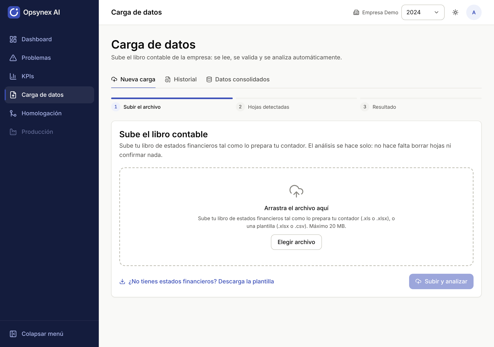
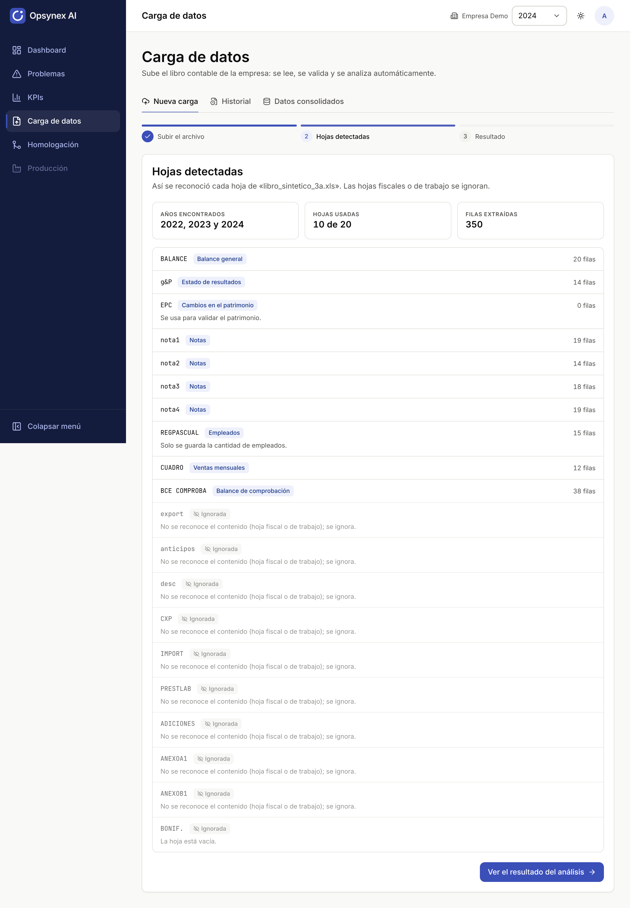
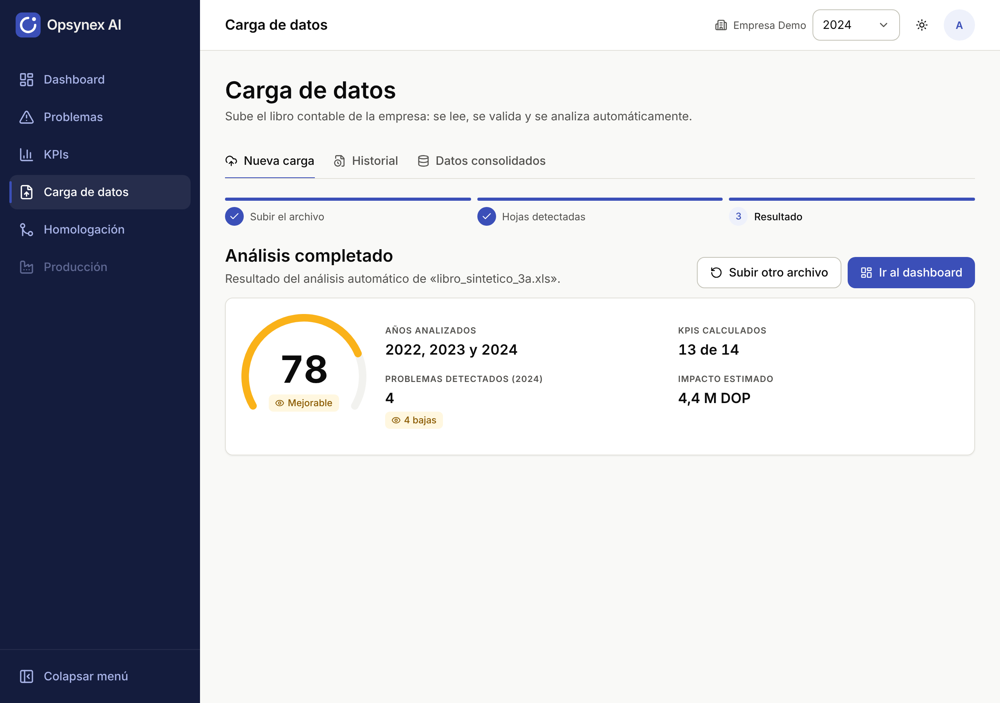
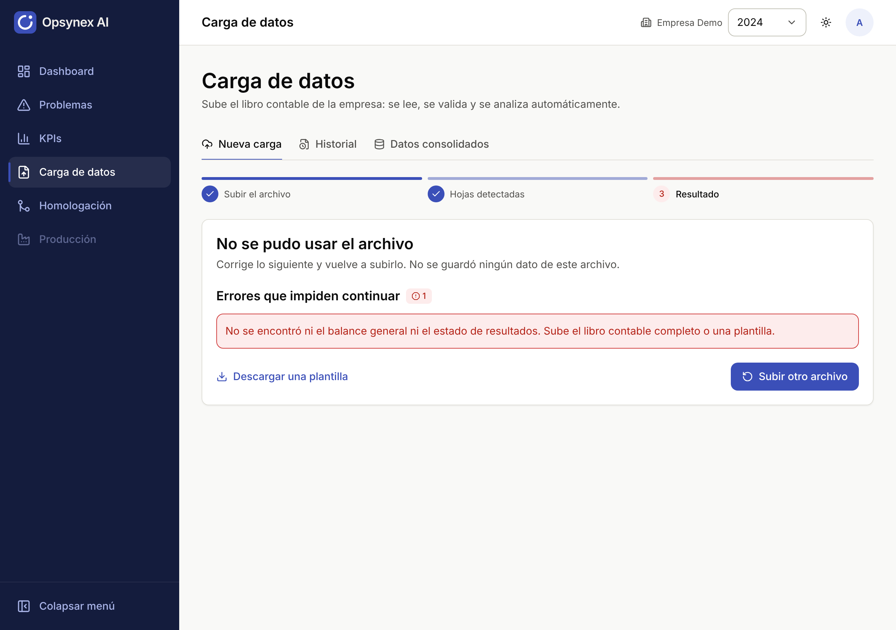
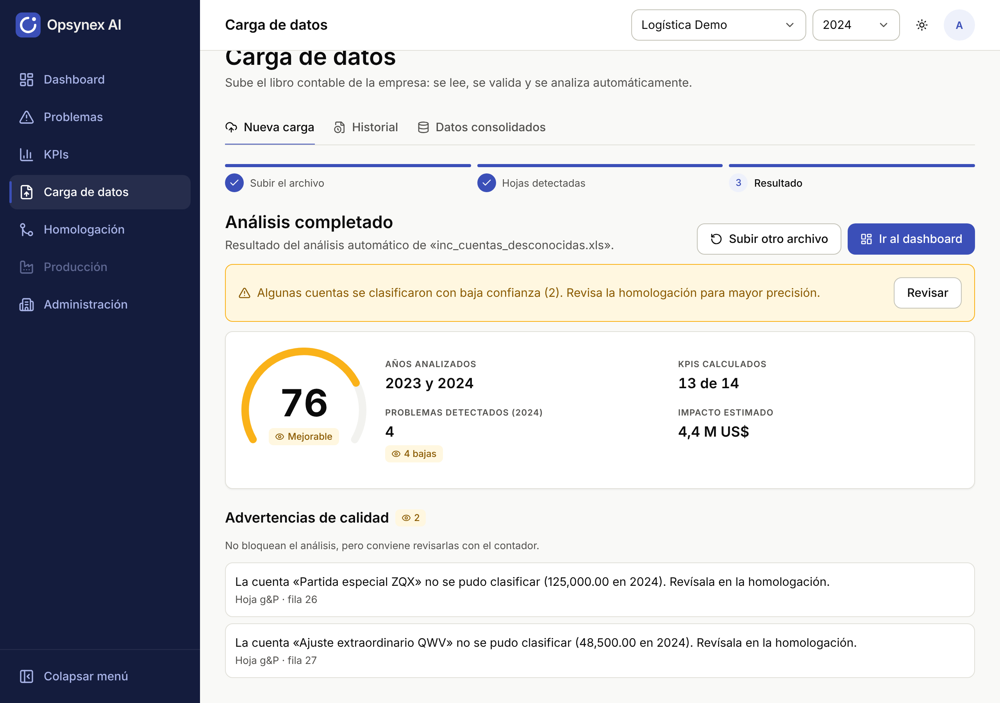
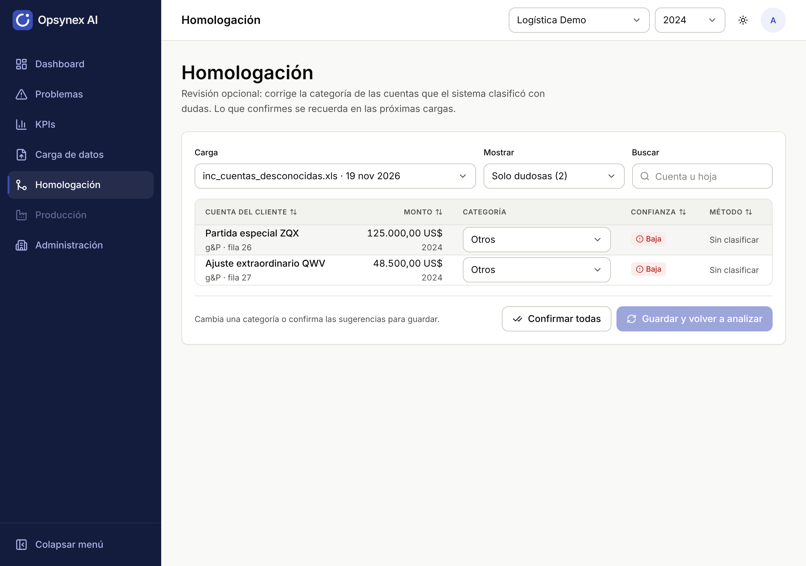
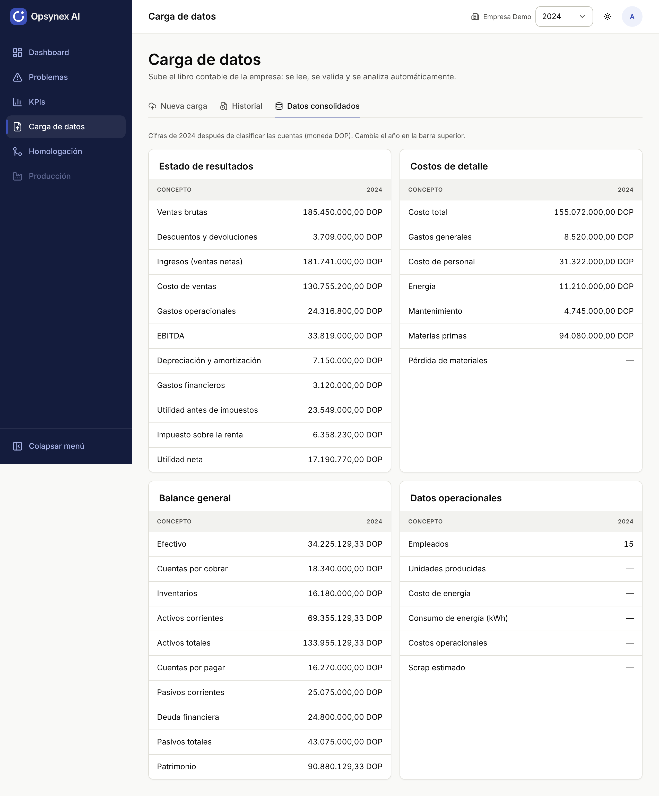
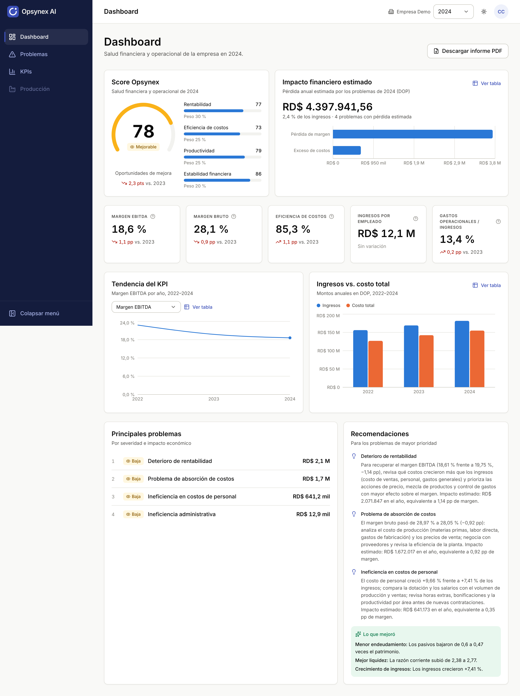
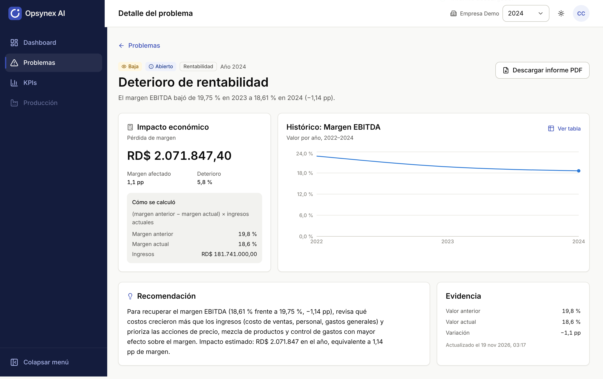
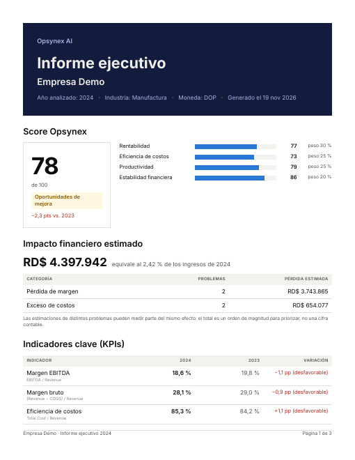

## Guía de usuario

### Roles

| Rol | Permisos |
|---|---|
| Admin | Crea empresas y usuarios; puede hacer todo lo del Analyst en cualquier empresa |
| Analyst | Sube archivos, revisa la homologación y vuelve a analizar |
| Client | Ve los resultados de su empresa |

### Iniciar sesión

1. Abre la plataforma y escribe el correo y la contraseña que te dio el administrador.
2. Si te equivocas, verás "Correo o contraseña incorrectos". Después de 5 intentos fallidos la
   cuenta se bloquea 15 minutos.
3. ¿Olvidaste tu contraseña? Pide al administrador que te asigne una nueva. No hay registro
   público: las cuentas solo las crea el administrador.

Por seguridad, la sesión dura 60 minutos. Al vencer, el sistema te lleva al inicio de sesión con
el aviso "Tu sesión expiró". Para salir antes, abre el menú de tu usuario (círculo con tus
iniciales, arriba a la derecha) y elige **Cerrar sesión**.

### Navegación

- **Menú lateral:** Dashboard, Problemas, KPIs y, para administradores y analistas, Carga de
  datos y Homologación. El administrador ve también **Administración**. Puedes colapsarlo para
  ver solo los iconos. En el teléfono se abre con el botón ☰.
- **Barra superior:** el administrador elige aquí la **empresa** que quiere consultar. Todos
  pueden elegir el **año** que quieren ver (por defecto, el más reciente).
- **Tema:** el botón del sol o la luna cambia entre modo claro, oscuro o el del sistema.

### Administración de empresas y usuarios (solo administrador)

En **Administración → Empresas**:
- **Nueva empresa:** nombre, industria (manufactura o servicios), sector opcional y moneda
  (código ISO, por ejemplo DOP). La industria y la moneda definen las referencias del análisis.
- **Eliminar:** solo se puede eliminar una empresa sin usuarios ni datos cargados.

En **Administración → Usuarios**:
- **Nuevo usuario:** nombre, correo, rol, empresa y contraseña inicial (al menos 8 caracteres,
  con letras y números). Los analistas y clientes deben pertenecer a una empresa. Comparte la
  contraseña por un canal seguro.
- **Editar:** cambia datos, rol, empresa o el estado activo. Si cambias el rol o la empresa, la
  persona debe volver a iniciar sesión.
- **Cambiar contraseña:** asigna una nueva y desbloquea la cuenta.
- **Desactivar:** la persona ya no puede entrar. Se puede reactivar desde **Editar**.
- Usa el buscador y los filtros de rol y empresa para encontrar usuarios.

### Qué archivos acepta el sistema

**Opción 1 — el libro contable completo (recomendado).** El mismo archivo de Excel que prepara
el contador (`.xls` o `.xlsx`), tal como está: con el balance general, el estado de ganancias y
pérdidas, las notas, la nómina, el cuadro de ventas mensuales, el balance de comprobación y las
hojas fiscales. No hace falta borrar hojas, filas ni fórmulas: el sistema reconoce cada hoja por
su contenido aunque su nombre cambie, y descarta las hojas fiscales o vacías.

**Opción 2 — una plantilla simple.** Para empresas sin estados formales, descarga la plantilla
(estado de resultados, balance general, flujo de efectivo, estructura de costos o datos
operacionales), escribe los montos de cada año y súbela como `.xlsx` o `.csv`. Si subes un CSV,
indica de qué tipo es. Deja vacío lo que no tengas: una celda vacía no es cero.

Límites: hasta 20 MB por archivo. El archivo original **no se guarda**: solo los montos
extraídos y el reporte de la carga.

### Privacidad

De la hoja de nómina solo se guarda la **cantidad de empleados** (total y por departamento) y la
suma de sueldos; nunca nombres, cédulas ni sueldos individuales. Los números de cuenta bancaria,
cédulas y RNC que aparezcan en las notas se reemplazan por `***`. Nada de esto se envía al
servicio de inteligencia artificial.

### Paso a paso: subir el libro contable (Analyst o Admin)

En **Carga de datos → Nueva carga** hay un asistente de tres pasos. El análisis se hace solo: no
hace falta confirmar nada para ver los resultados.

1. **Subir el archivo.** Arrastra el libro contable (`.xls` o `.xlsx`) al recuadro o pulsa
   **Elegir archivo**, y luego **Subir y analizar**. Una barra muestra el avance del envío y
   después el análisis. Si el archivo no es `.xls`, `.xlsx` ni `.csv`, o supera 20 MB, se avisa
   antes de enviarlo. Si subes un CSV, puedes indicar qué plantilla es. Si no tienes estados
   financieros, usa el enlace **¿No tienes estados financieros? Descarga la plantilla**.

   {width=90%}

2. **Hojas detectadas.** Verás cada hoja con el tipo reconocido (Balance general, Estado de
   resultados, Notas, Empleados, Ventas mensuales…) y las filas extraídas. Arriba aparecen los
   años encontrados. Las hojas fiscales o de trabajo aparecen atenuadas como **Ignoradas**, con
   el motivo. Pulsa **Ver el resultado del análisis**.

   {width=90%}

3. **Resultado.** Muestra:
   - el score;
   - los años analizados;
   - los KPIs calculados (por ejemplo, 13 de 14);
   - los problemas detectados por severidad;
   - el impacto estimado;
   - las advertencias de calidad, con su hoja, fila y columna.

   Pulsa **Ir al dashboard** para ver el detalle.

   {width=90%}

Si el archivo tiene un **error que impide usarlo** (por ejemplo, no trae ni balance ni estado de
resultados), el paso 3 explica qué falta y no deja continuar. Corrígelo y pulsa **Subir otro
archivo**. No se guarda ningún dato de un archivo con errores.

{width=90%}

### Revisión de cuentas (opcional)

Si alguna cuenta importante se clasificó con poca seguridad, el resultado muestra el aviso
**«Algunas cuentas se clasificaron con baja confianza. Revisa la homologación para mayor
precisión»** con el botón **Revisar**.

{width=90%}

En **Homologación**:

1. Elige la carga. Por defecto se muestran **solo las cuentas dudosas**; cambia a **Todas**
   para ver el resto.
2. Cada fila muestra la cuenta del cliente (con su hoja, fila y sección), el monto, la
   **categoría** asignada, la **confianza** (Alta, Media o Baja) y el **método**. El método puede
   ser automático, IA, diccionario local, confirmado o sin clasificar.
3. Cambia la categoría donde haga falta, o pulsa **Confirmar todas** para aceptar las
   sugerencias visibles.
4. Pulsa **Guardar y volver a analizar**. El resumen se actualiza y muestra qué cambió (por
   ejemplo, «Score 64,0 → 67,0» o «Cuentas dudosas 2 → 0»).

{width=90%}

Lo que confirmes se recuerda para la empresa: en las cargas siguientes esas cuentas se
clasifican solas.

### Historial y datos consolidados

- **Historial:** cada carga con su estado (Analizada, Con errores…), un aviso si se recomienda
  revisión, la fecha, quién la subió, los años, las filas y las advertencias. **Ver reporte**
  abre el detalle de hojas y advertencias.
- **Datos consolidados:** las cifras del año elegido en la barra superior, ya clasificadas
  (estado de resultados, costos de detalle, balance y datos operacionales). Son de solo lectura.

{width=90%}

### Cómo leer el resultado de una carga

Después de subir el archivo verás:

- **Años detectados** (por ejemplo 2023 y 2024).
- **Hojas:** cada hoja con el tipo que se reconoció y cuántas filas se leyeron, o "ignorada" y el
  motivo (por ejemplo "hoja fiscal" o "hoja vacía").
- **Errores** (rojo): impiden usar el archivo. Ocurren si el archivo está dañado, vacío, no es
  de Excel, o no tiene ni balance ni estado de resultados. Corrige el archivo y vuelve a subirlo.
- **Advertencias** (ámbar): el archivo se usa igual, pero conviene revisarlo. Cada una indica la
  hoja, la fila y la columna:

| Advertencia | Qué significa y qué hacer |
|---|---|
| El balance no cuadra | El total de activos no es igual al de pasivos y capital (más allá del redondeo). Revisa los totales en la hoja indicada. |
| La nota no cuadra con el estado | El detalle de una nota suma distinto que la línea del estado que desglosa. Revisa ambas cifras. |
| Patrimonio | El estado de cambios en el patrimonio no refleja la ganancia del año o su saldo no coincide con el balance. |
| Balance de comprobación no confiable | No cuadra, tiene bancos o inventarios negativos o sus ventas no coinciden. Se usan los estados financieros, que son la fuente principal. |
| Nombre de empresa distinto | Una hoja tiene otro nombre de empresa en su encabezado. Verifica que todas las hojas sean de la misma empresa. |
| Subtotal no cuadra | Un total no es la suma de sus líneas. |
| Año faltante | Un estado no trae alguno de los años que sí traen los demás. |

### Análisis automático y revisión de cuentas (opcional)

Al subir un archivo válido, el sistema **analiza solo, sin pasos manuales**: clasifica cada cuenta
del cliente en una categoría estándar (ingresos, costo de ventas, energía, mantenimiento,
personal…), suma los valores por año y deja los datos listos. No hace falta confirmar nada para
ver los resultados.

Si alguna cuenta importante de los estados no se reconoce con seguridad, verás el aviso
**"Revisión recomendada"** con la lista de cuentas dudosas y su monto. Para revisarlas:

1. Abre la revisión de cuentas de la carga. Primero aparecen las dudosas.
2. Para cada cuenta verás su hoja, su fila, la categoría sugerida y la confianza. Si la sugerencia
   es correcta, confírmala; si no, elige la categoría correcta.
3. Pulsa **"Guardar y volver a analizar"**. Los datos se recalculan con tus correcciones.

Las cuentas que confirmas o corriges **se recuerdan** para tu empresa: en las cargas siguientes
se aplican solas. Las líneas de las notas (por ejemplo "Energía Eléctrica") solo se usan para los
indicadores de detalle (energía, mantenimiento, personal, materias primas), así que nunca se suman
dos veces con los estados.

Si el servicio de inteligencia artificial no está disponible, el análisis se hace igual con un
diccionario básico. Es posible que veas más cuentas para revisar.

### Cómo leer el score, los problemas y su impacto

**Score Opsynex (0–100).** Resume la salud financiera y operacional de cada año:

| Score | Qué significa |
|---|---|
| 80–100 | Operación saludable |
| 60–79 | Hay oportunidades de mejora |
| Menos de 60 | Deterioro operacional significativo |

El score combina cuatro componentes: rentabilidad (30 %), eficiencia de costos (25 %),
productividad (25 %) y estabilidad financiera (20 %). Cada uno compara tus indicadores con valores
de referencia de tu industria. Si falta información para un componente (por ejemplo, la cantidad
de empleados de un año), su peso se reparte entre los demás y el sistema lo indica.

**Problemas.** Cada problema muestra:

- La severidad: alta, media o baja.
- Qué pasó, con las cifras del año.
- Una recomendación con esas cifras.

Están ordenados por prioridad: primero los más severos y, dentro de cada severidad, los de mayor
impacto económico.

**Impacto estimado.** Es la pérdida aproximada del año que causa el problema, en tu moneda, y los
puntos de margen que representa. Por ejemplo, si el margen EBITDA bajó 3 puntos, el impacto es
aproximadamente el 3 % de las ventas del año. Las alertas de liquidez y endeudamiento señalan un
riesgo y no muestran una pérdida. El impacto total suma las estimaciones de todos los problemas.
Algunos problemas miden parte del mismo efecto, así que el total es una guía para priorizar y no
una cifra contable.

### El dashboard

El **Dashboard** muestra la empresa y el año elegidos en la barra superior. Los bloques van en
este orden:

1. **Score Opsynex.** El número de 0 a 100 con su banda (Saludable, Mejorable o Deterioro),
   la variación frente al año anterior y los cuatro componentes con su peso. Si a un componente
   le faltan datos, aparece «Sin datos» y un icono **?** explica por qué.
2. **Impacto financiero estimado.** El total del año, el porcentaje de los ingresos que
   representa y las barras por categoría (pérdida de margen, exceso de costos…).
3. **KPIs principales.** Margen EBITDA, margen bruto, eficiencia de costos, ingresos por
   empleado y gastos operacionales. La flecha indica si el valor subió o bajó; el **verde**
   significa que el cambio es bueno y el **rojo**, que es malo. Por ejemplo, si la eficiencia de
   costos sube, se muestra en rojo, porque significa que los costos pesan más. El icono **?**
   muestra la fórmula.
4. **Tendencias.** Un KPI por año (elígelo en el selector) y las barras de ingresos frente al
   costo total.
5. **Principales problemas y recomendaciones.** Los cinco problemas más prioritarios con su
   severidad e impacto, las recomendaciones de los tres primeros y «Lo que mejoró».

Cada gráfico tiene **Ver tabla** para ver los mismos datos en números.

{width=95%}

### Problemas y su detalle

En **Problemas**, filtra por año, severidad, categoría o estado. La tabla se ordena por
prioridad, y puedes ordenarla por impacto pulsando la columna. Al abrir un problema verás:

- **Descripción y severidad**, con su estado (Abierto, Reconocido o Resuelto).
- **Impacto económico**, con el margen afectado, la magnitud del deterioro y **cómo se calculó**
  (la fórmula y los valores usados).
- **Histórico** del indicador relacionado, año por año.
- **Recomendación** y la **evidencia** (los valores que dispararon la regla).

El analista o el administrador puede cambiar el **estado**. Se conserva aunque se vuelva a
analizar.

{width=95%}

### KPIs

La página **KPIs** muestra todos los indicadores por año en una tabla, con la variación del
último año, y debajo un gráfico por indicador.

### Informe PDF

El botón **Descargar informe PDF** aparece en el dashboard y en el detalle de cada problema, y
está disponible para todos los roles. Descarga un informe en tamaño Carta con:
- la portada (empresa, año y fecha);
- el score y sus componentes;
- el impacto total y por categoría;
- la tabla de KPIs con la variación anual;
- el gráfico de ingresos y costos;
- los problemas con su recomendación;
- las advertencias de calidad de los datos;
- una nota metodológica.

{width=60%}

### Recomendaciones y resumen con inteligencia artificial

- **Resumen ejecutivo:** en el dashboard aparece una lectura gerencial del año, de 3 a 5
  párrafos, con **3 prioridades**. Lleva la etiqueta **Generado con IA** y la fecha. El analista
  o el administrador puede pulsar **Regenerar** para pedir una versión nueva; mientras se genera
  verás «Generando el análisis con IA…». Suele tardar menos de un minuto.
- **Recomendación IA de un problema:** en el detalle de los problemas de severidad alta y media,
  la pestaña **Recomendación IA** muestra un diagnóstico, las **causas raíz** probables y
  **acciones**. Cada acción indica su esfuerzo (bajo, medio o alto) y su horizonte (corto: menos
  de 3 meses; mediano: 3 a 12 meses; largo: más de 12 meses). La pestaña **Recomendación base**
  siempre está disponible.
- **Anomalías:** si las ventas de un mes se alejan mucho de lo habitual, aparece un problema de
  severidad baja «Ventas mensuales atípicas (mes)». Verifica el registro de ese mes: puede ser
  una venta extraordinaria, una devolución o un error de carga.

**Límites de la IA:**
- Trabaja solo con los indicadores agregados de la empresa. Nunca recibe nombres, cédulas ni
  salarios.
- No conoce el mercado ni la operación por dentro: sus causas son **probables**, no
  comprobadas.
- Las recomendaciones son orientativas. Valídalas con tu equipo y con el contador antes de
  decidir, y verifica las cifras.
- Si la IA no está configurada o no está disponible, el sistema lo indica y sigue funcionando
  con las recomendaciones base.

{width=80%}
