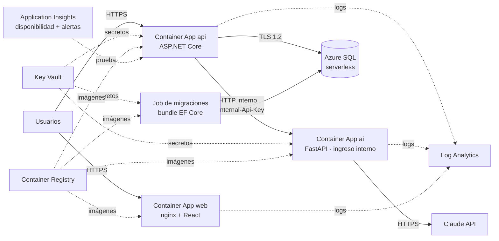

## Despliegue y operación

Opsynex AI se despliega en **Microsoft Azure** (la opción más natural para .NET y SQL Server).
Todo está automatizado:

- **Infraestructura como código:** Bicep, en `infra/`.
- **Despliegue continuo:** GitHub Actions, en `.github/workflows/deploy.yml`.
- **Preparación única:** un script, `scripts/azure-bootstrap.sh`.

Los secretos viven en Key Vault y GitHub se autentica con OIDC, sin contraseñas guardadas.

> **Estado al cierre de la etapa 14:** todo está listo para desplegar, pero el primer
> despliegue necesita una suscripción de Azure. Hay que ejecutar el bootstrap con la cuenta del
> cliente. Hasta entonces, el workflow «Deploy» termina sin hacer nada y lo indica.

### Arquitectura en la nube



| Recurso | Nombre | Para qué |
|---|---|---|
| Container Apps Environment | `cae-opsynex` | Red y escalado de las apps; logs a Log Analytics |
| Container App `opsynex-web` | ingreso **público** HTTPS | Frontend (nginx sin privilegios, CSP) |
| Container App `opsynex-api` | ingreso **público** HTTPS | API; sondas `/health/live` y `/health/ready` |
| Container App `opsynex-ai` | ingreso **interno** | Servicio de IA: solo lo alcanza el API (`http://opsynex-ai`); no tiene URL pública |
| Container Apps Job `opsynex-migrations` | manual | Aplica las migraciones (bundle de EF Core) antes de cada versión |
| Azure SQL `sql-opsynex-…` / base `Opsynex` | General Purpose serverless (0,5–1 vCore, pausa automática a los 60 min) | Datos; TDE, TLS 1.2, backups automáticos |
| Key Vault `kv-opsynex-…` | RBAC + purge protection | Secretos de producción |
| Container Registry `opsynexacr…` | Basic, sin usuario admin | Imágenes etiquetadas con el commit |
| Identidad administrada `id-opsynex-apps` | — | Las apps leen el ACR (AcrPull) y Key Vault (Secrets User) sin contraseñas |
| Log Analytics `log-opsynex` | 30 días, tope 2 GB/día | Logs estructurados (con `CorrelationId`) |
| Application Insights `appi-opsynex` | — | Prueba de disponibilidad cada 15 min y alertas |

**Seguridad de red:**

- El servicio de IA no tiene ingreso externo.
- La web y el API solo aceptan HTTPS: HTTP se redirige y el certificado lo administra Azure.
- Azure SQL solo admite conexiones de servicios de Azure, con TLS 1.2.
- **Mejora opcional (más costo):** una red virtual con *private endpoint* para SQL y Key Vault, y
  el entorno de Container Apps dentro de esa red.

### Contenedores de producción

| Imagen | Base | Usuario | Notas |
|---|---|---|---|
| `opsynex-api` | `dotnet/aspnet:10.0` | `app` (no root) | Puerto 8080; incluye los libros sintéticos para `seed-demo` |
| `opsynex-migrations` | `dotnet/runtime-deps:10.0` | `app` | Bundle autocontenido `efbundle`; lee `ConnectionStrings__Default`; idempotente |
| `opsynex-ai` | `python:3.12-slim` | `appuser` (10001) | uvicorn con `UVICORN_WORKERS` procesos (2) |
| `opsynex-web` | `nginx-unprivileged:1.27-alpine` | `nginx` | Puerto 8080, `/healthz`, CSP con `API_ORIGIN` |

Para probar en modo producción en local, con las mismas imágenes:

```bash
cp .env.example .env   # define MSSQL_SA_PASSWORD, AiService__ApiKey y Jwt__Secret
docker compose -f docker-compose.prod.yml up -d --build
# frontend http://localhost:8081 · API http://localhost:8080/health
```

La compose ejecuta primero las migraciones y luego el API. La IA no publica puertos.

### Preparación única (bootstrap)

Requiere Azure CLI con sesión iniciada (`az login`) y permisos de **Owner** en la suscripción, o
Contributor más User Access Administrator.

```bash
GITHUB_REPO=Luis-Pichardo/opsynex-ai \
SEED_ADMIN_EMAIL=admin@empresa-del-cliente.com \
ALERT_EMAIL=operacion@empresa-del-cliente.com \
ANTHROPIC_API_KEY=sk-ant-... \
bash scripts/azure-bootstrap.sh
```

`ANTHROPIC_API_KEY` es opcional: sin ella, la IA generativa queda desactivada y se usan las
recomendaciones base.

El script es idempotente y **nunca sobrescribe un secreto existente**. Hace lo siguiente:

1. Registra los proveedores de recursos.
2. Crea el grupo de recursos `rg-opsynex-prod`, en `eastus2` por defecto (`AZURE_LOCATION`).
3. Crea el Key Vault y **genera** los secretos.
4. Crea la aplicación de Entra ID con credenciales federadas para `main` y el entorno
   `production` de GitHub, con los roles Contributor y Role Based Access Control Administrator
   sobre el grupo de recursos.
5. Muestra las variables de GitHub Actions, o las configura con `gh` si está autenticado.

| Variable de GitHub (Settings → Secrets and variables → Actions → **Variables**) | Contenido |
|---|---|
| `AZURE_CLIENT_ID` / `AZURE_TENANT_ID` / `AZURE_SUBSCRIPTION_ID` | Identidad OIDC del pipeline |
| `AZURE_RESOURCE_GROUP` | `rg-opsynex-prod` |
| `AZURE_KEY_VAULT` | Nombre del Key Vault |
| `SEED_ADMIN_EMAIL` | Correo del primer Admin |
| `ALERT_EMAIL` | Correo que recibe las alertas |

Ninguna variable es secreta. Opcionalmente, crea el entorno **production** en GitHub
(Settings → Environments) con *required reviewers* para aprobar cada despliegue.

### Secretos (Key Vault)

| Secreto | Lo usa | Origen |
|---|---|---|
| `sql-admin-password` | Bicep (servidor SQL) | Generado por el bootstrap |
| `sql-connection` | API y job de migraciones | Lo escribe Bicep con el servidor y la contraseña |
| `jwt-secret` | API | Generado (64 caracteres) |
| `ai-service-api-key` | API e IA | Generado |
| `seed-admin-password` | API (primer Admin) | Generado; se lee con `az keyvault secret show` |
| `anthropic-api-key` | IA | `ANTHROPIC_API_KEY` o `disabled` (la plataforma funciona con las recomendaciones base) |

Las apps leen los secretos con la identidad administrada. Al cambiar un secreto en Key Vault, se
toma en la siguiente revisión: vuelve a ejecutar el workflow Deploy o reinicia la app.

### Despliegue automático (CI/CD)

Al hacer **merge a `main`**, la CI se ejecuta: build, pruebas, cobertura, auditorías, Bicep y E2E.
Si termina en verde, se dispara **Deploy**. También se puede lanzar a mano desde Actions → Deploy
→ Run workflow.

| Paso | Qué hace |
|---|---|
| 1. Infraestructura base | `az deployment group create` con `infra/main.bicep` (monitoreo, ACR, identidad, SQL, entorno). Idempotente |
| 2. Imágenes | `docker build` de las 4 imágenes etiquetadas con el SHA del commit y `docker push` al ACR. El frontend incrusta la URL del API |
| 3. Job de migraciones | Actualiza el job con la nueva imagen |
| 4. Migraciones | `az containerapp job start` y espera el resultado. Si fallan, **no** se despliega la nueva versión |
| 5. Apps | Nueva revisión de `web`, `api` y `ai` (modo de revisión única: Container Apps cambia sin cortar el tráfico cuando la sonda *readiness* pasa) |
| 6. Prueba de humo | `GET /health/ready` del API y `/healthz` de la web. El resumen del workflow muestra las URLs y la versión |

Las migraciones son solo hacia adelante y deben ser compatibles con la versión anterior durante
el cambio. Una columna nueva se agrega como nullable; se elimina en una versión posterior.

**Revertir una versión:**

- **Preferido:** `git revert` del commit en `main`, que vuelve a desplegar.
- **Urgente:** `az containerapp update -n opsynex-api -g rg-opsynex-prod --image <acr>/opsynex-api:<sha-anterior>`
  (lo mismo para `web` y `ai`).

### URL pública y HTTPS

Tras el primer despliegue, la plataforma responde en:

- **Aplicación:** `https://opsynex-web.<dominio-del-entorno>.<región>.azurecontainerapps.io`
- **API:** `https://opsynex-api.<dominio-del-entorno>.<región>.azurecontainerapps.io`

Las dos URLs se muestran en el resumen del workflow. Usan certificado administrado por Azure.

**Dominio propio** (por ejemplo `app.cliente.com` y `api.cliente.com`):

1. Agrega en el DNS un registro `CNAME` hacia el FQDN de la app y un `TXT` `asuid.app` con el id de
   verificación (`az containerapp show -n opsynex-web -g rg-opsynex-prod --query properties.customDomainVerificationId`).
2. Agrega el dominio y su certificado administrado:
   `az containerapp hostname add -n opsynex-web -g rg-opsynex-prod --hostname app.cliente.com`, y luego
   `az containerapp hostname bind -n opsynex-web -g rg-opsynex-prod --hostname app.cliente.com --environment cae-opsynex --validation-method CNAME`.
   Repite con `opsynex-api` y `api.cliente.com`.
3. Actualiza `Cors__Origins` del API y la `VITE_API_URL` del frontend con los dominios nuevos.
   Para eso, ajusta `webUrl` y `apiUrl` en `infra/modules/apps.bicep` (o agrega parámetros de dominio) y despliega.

### Backups y restauración

- **Automáticos (Azure SQL):** completos semanales, diferenciales cada 12 h y de log cada 5–10
  min, con almacenamiento **geo-redundante**.
- **Restauración a un punto en el tiempo (PITR):** cualquier momento de los últimos **14 días**.
- **Retención larga (LTR):** semanal 4 semanas, mensual 12 meses, anual 5 años.

Restaurar a un punto en el tiempo crea una base nueva. Luego se apunta `sql-connection` a ella o
se renombran las bases:

```bash
az sql db restore -g rg-opsynex-prod -s <servidor> -n Opsynex \
  --dest-name Opsynex-restaurada --time "2026-12-01T13:00:00Z"
```

Las LTR se listan con `az sql db ltr-backup list -l eastus2 -s <servidor> -d Opsynex` y se restauran
con `az sql db ltr-backup restore`. Prueba una restauración cada trimestre y anota el tiempo que
tomó.

Los archivos subidos **no se guardan** (privacidad), así que la base de datos es todo lo que hay
que respaldar. El Key Vault tiene borrado suave de 90 días y protección contra purga.

### Monitoreo y alertas

| Alerta | Condición | Severidad |
|---|---|---|
| Disponibilidad del API | `/health/ready` falla desde 2 o más regiones (prueba cada 15 min) | 1 |
| Errores del API | Más de 10 respuestas 5xx en 5 minutos | 2 |
| Espacio de la base | Más del 80 % del tamaño máximo (32 GB) | 2 |
| CPU de la base | Más del 80 % durante 15 minutos | 3 |

Todas notifican por correo a `ALERT_EMAIL` (grupo de acciones `ag-opsynex`).

**Consultas útiles** (Log Analytics → Logs):

```kusto
// Todo lo de una petición, con el id de correlación que el usuario ve en un error
ContainerAppConsoleLogs_CL
| where Log_s has "<correlationId>"
| project TimeGenerated, ContainerAppName_s, Log_s
| order by TimeGenerated asc

// Errores del API en las últimas 24 h
ContainerAppConsoleLogs_CL
| where ContainerAppName_s == "opsynex-api" and Log_s has " ERR] "
| where TimeGenerated > ago(24h)

// Reinicios y eventos de las apps
ContainerAppSystemLogs_CL | where TimeGenerated > ago(24h) | project TimeGenerated, ContainerAppName_s, Reason_s, Log_s
```

La salud completa (`GET /health`) devuelve el estado de la base de datos y del servicio de IA.
Si la IA no responde, el estado es `Degraded` y la plataforma sigue funcionando.

### Escalado

| App | Mínimo | Máximo | Regla | CPU / memoria |
|---|---|---|---|---|
| api | 1 | 3 | 50 peticiones concurrentes por réplica | 1 vCPU / 2 GiB |
| ai | 1 | 2 | 20 peticiones concurrentes | 0,5 vCPU / 1 GiB |
| web | 1 | 2 | 100 peticiones concurrentes | 0,25 vCPU / 0,5 GiB |

Los límites se cambian en `infra/main.bicepparam` y `infra/modules/apps.bicep`. Con más de una
réplica del API hay que tener en cuenta dos cosas:

- El estado del trabajo de IA en curso (`AiJobTracker`) y los límites de peticiones viven en la
  memoria de cada réplica. Los datos y los resultados están en la base y son consistentes.
- Si se necesitan más réplicas de forma sostenida, conviene mover ese estado a Redis.

La base serverless escala sola entre 0,5 y 1 vCore. Para más volumen se sube `skuName` (por
ejemplo `GP_S_Gen5_2`).

### Operación diaria

| Tarea | Cómo |
|---|---|
| Entrar por primera vez | Correo `SEED_ADMIN_EMAIL`. Contraseña: `az keyvault secret show --vault-name <kv> -n seed-admin-password --query value -o tsv`. Cámbiala en Administración → Usuarios |
| Crear empresas y usuarios | En la aplicación, como Admin (no hay auto-registro) |
| Activar la IA generativa | `az keyvault secret set --vault-name <kv> -n anthropic-api-key --value sk-ant-...` y luego ejecutar Deploy (nueva revisión) |
| Rotar el secreto JWT | Nuevo valor en `jwt-secret` y Deploy. Todas las sesiones se cierran y los usuarios vuelven a entrar |
| Rotar la contraseña de SQL | `az sql server update --admin-password …`, guardarla en `sql-admin-password` y ejecutar Deploy (Bicep reescribe `sql-connection`) |
| Ver logs en vivo | `az containerapp logs show -n opsynex-api -g rg-opsynex-prod --follow` |
| Datos de demostración | **No** en producción con datos reales. En un entorno de demo: `az containerapp exec -n opsynex-api -g <rg> --command "dotnet Opsynex.Api.dll seed-demo"` |
| Pausar costos (entorno de pruebas) | Poner `minReplicas: 0` en las apps (la primera petición tarda unos segundos); la base ya se pausa sola |

### Costos estimados

Valores de referencia en USD por mes para `eastus2`, con precios públicos de noviembre de 2026.
Hay que confirmarlos en la [calculadora de Azure](https://azure.microsoft.com/pricing/calculator/)
antes de presentarlos como presupuesto.

| Componente | Supuesto | USD/mes |
|---|---|---|
| Container Apps (api, ai, web) | 1 réplica mínima de cada una, 24/7 (1,75 vCPU y 3,5 GiB). Casi siempre en reposo, con picos en horario laboral | 40 – 130 |
| Azure SQL serverless | 0,5–1 vCore unas 200 h/mes activas (pausa fuera de horario) y 32 GB | 60 – 100 |
| Backups (PITR geo + LTR) | Pocas decenas de GB | 5 – 15 |
| Container Registry Basic | 10 GB incluidos | 5 |
| Log Analytics + Application Insights | Menos de 5 GB/mes de logs; prueba de disponibilidad cada 15 min desde 3 regiones | 10 – 20 |
| Key Vault, alertas e identidad | Pocas operaciones | 1 – 3 |
| **Total infraestructura** | | **≈ 120 – 270** |

**Consumo de Claude** (Claude Opus 5.5: USD 4 por millón de tokens de entrada, 20 de salida y
0,20 de lectura de caché):

- Un análisis completo hace un resumen ejecutivo más hasta 10 recomendaciones: unos 34.000 tokens
  de entrada y 28.000 de salida (con el razonamiento). Eso cuesta **≈ USD 0,70**.
- El hash de la entrada evita volver a generar si los datos no cambian. Volver a subir el mismo
  libro no cuesta nada.

| Uso mensual | Opus 5.5 | Sonnet 5.5 (USD 2 / 10) | Haiku 5.5 (USD 0,10 / 0,50) |
|---|---|---|---|
| 50 análisis | ≈ USD 35 | ≈ USD 18 | ≈ USD 1 |
| 200 análisis | ≈ USD 140 | ≈ USD 70 | ≈ USD 4 |

El modelo se cambia con `ANTHROPIC_MODEL` en el servicio de IA (parámetro `anthropicModel` de
Bicep). Bajar a Sonnet o Haiku reduce el costo, pero conviene validar antes la calidad de las
recomendaciones con un conjunto de ejemplos. El tope por análisis se controla con
`Ai__MaxRecommendations`.

### Lista de verificación de salida a producción

- [ ] Bootstrap ejecutado y variables de GitHub configuradas.
- [ ] Workflow Deploy en verde. La URL pública responde con HTTPS y `/health/ready` está `Healthy`.
- [ ] Primer Admin creado y su contraseña cambiada.
- [ ] Alerta de prueba recibida en `ALERT_EMAIL`. Para forzarla: detener el API 15 min o enviar una prueba desde el grupo de acciones.
- [ ] Restauración PITR probada en una base temporal.
- [ ] Dominio propio y CORS actualizados (si aplica).
- [ ] `ANTHROPIC_API_KEY` real cargada y resumen con IA validado (pendiente de la etapa 11).
